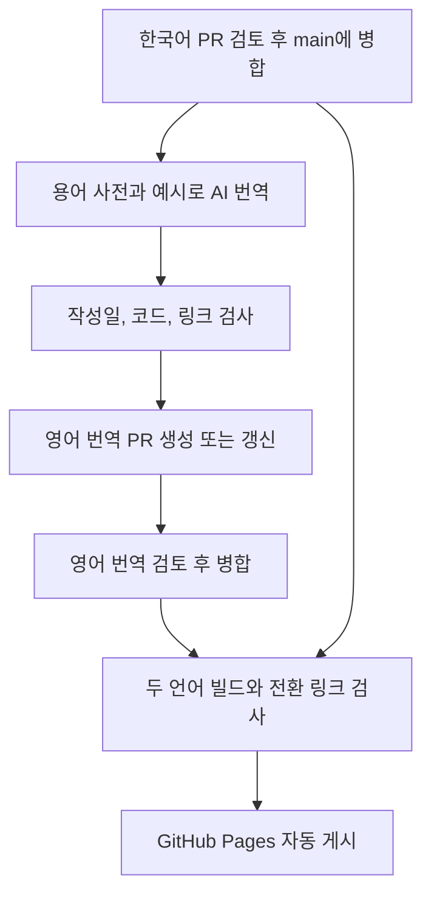

# HyoYoonNam Blog

Docusaurus로 만든 한국어, 영어 개발 블로그입니다.

## 글 작성

한국어 글은 `blog/YYYY-MM-DD-slug/index.md` 또는 `index.mdx`에 작성합니다. 같은 폴더에 사진을 두고 상대 경로로 참조합니다.

```yaml
---
slug: reading-java
title: "자바 코드를 읽는 법"
date: 2026-11-19T21:00:00+09:00
authors: hyoyoonnam
tags: [기술]
---
```

`date`에는 원래 작성 시각과 시간대를 적습니다. 기존 글처럼 `date`가 없으면 폴더의 날짜를 사용합니다. `slug`는 글의 주소이며 두 언어에 동일하게 적용됩니다. `draft: true`인 글은 번역 대상에서 제외됩니다.

## 영어 번역 흐름

번역 흐름과 선택 근거는 구현과 같은 PR에서 함께 검토하고 갱신할 수 있도록 이 README에 둡니다.



`main`에 한국어 글을 추가하거나 수정하면 [번역 워크플로](.github/workflows/translate-blog.yml)가 실행됩니다. 영어판은 `i18n/en/docusaurus-plugin-content-blog/` 아래에 원문과 같은 폴더명으로 생성됩니다. `date`, `slug`, 작성자, 태그 등은 원문에서 복사하고 제목, 요약, 본문을 번역합니다. 사진은 원본을 가리키는 상대 심볼릭 링크로 연결합니다.

글마다 고정된 작업 브랜치를 사용합니다. 매 실행마다 현재 main의 번역 누락과 원문 변경을 함께 탐색하므로 연속 push의 대기 실행이 취소돼도 다음 실행에서 처리합니다. 원문을 다시 수정하면 그 글의 열린 번역 PR을 갱신합니다. 재실행할 때 원문과 용어 사전의 해시가 모두 같은 번역이 있으면 재사용합니다. 글 여러 편을 올리면 각각 PR이 생깁니다. 각 PR은 사람이 문체와 의미를 확인하고 독립 검토를 거쳐 병합합니다. [게시 워크플로](.github/workflows/deploy-blog.yml)가 main에 병합된 커밋을 빌드하고, 검사를 통과한 한국어와 영어 사이트를 GitHub Pages에 자동 게시합니다. 한국어 원문을 병합했을 때도 게시되며, 영어판은 번역 PR을 병합하면 반영됩니다.

Actions의 **Translate blog to English → Run workflow**에서도 실행할 수 있습니다. `post_path`에 한국어 파일 경로를 넣으면 해당 글을 처리하고, 비우면 영어판이 없거나 원문이 바뀐 글을 찾습니다. 기본값인 `dry_run`을 켜면 API 호출과 빌드까지 확인합니다. PR을 생성하려면 `dry_run`을 해제합니다.

원문에 있는 코드 블록, 링크, 이미지 경로와 MDX 실행 구문을 검사하고, 두 언어의 빌드 결과에서 발행 시각, 한국 기준 표시 날짜와 같은 글의 전환 링크를 대조합니다. 다른 글의 번역이 대기 중이면 해당 글은 검사를 보류하고 생성한 번역을 검사합니다. PR 생성 직전에 같은 원문이 다시 바뀌었다면 실행을 중단하고 다음 실행에서 새 원문을 처리합니다. 오류가 나면 워크플로 로그에서 원인을 확인한 뒤 수정하고 재실행합니다.

## 번역 용어 사전

[translation/glossary.json](translation/glossary.json)에 한국어, 선호하는 영어 표현, 적용 문맥을 기록합니다. 기술 용어, 서비스명, 저자의 별명과 작품명 24개를 초기 항목으로 넣었습니다. 번역 요청마다 승인된 번역 예시와 함께 전달합니다.

```json
{
  "korean": "우테코",
  "english": "Woowacourse",
  "note": "우아한테크코스의 줄임말이다."
}
```

새 항목은 파일의 `terms` 배열에 추가하고 PR로 검토합니다. `korean`은 중복 없이 작성하고 `english`, `note`도 채웁니다. 문맥에 따라 뜻이 달라지는 말은 적용 조건을 `note`에 적습니다. 코드, URL과 메타데이터는 보존하고, 본문의 표현을 고를 때 용어 사전을 참고합니다.

사전 변경은 이후 번역 요청부터 적용됩니다. 열린 번역 PR을 새 사전으로 갱신하려면 원문 경로를 지정해 번역 워크플로를 다시 실행합니다. 이미 병합한 영어판도 같은 방법으로 재번역 PR을 만들 수 있습니다. 사전 해시가 바뀌면 기존 자동 번역의 재사용을 중단하고 새로 번역합니다.

## API와 모델을 선택한 이유

현재 설정은 **Responses API**, 모델은 **`gpt-5.4-2026-03-05`**, 추론 강도는 `low`입니다.

- Responses API는 원문과 번역 지시를 한 요청에 넣고 결과를 받을 수 있습니다. Structured Outputs로 제목, 요약, 문장 조각의 번역을 정해진 JSON 형식으로 받습니다. 원문의 Markdown 구조와 코드, 링크는 코드에서 유지하고 문장 조각을 해당 위치에 반영합니다.
- GPT-5.4는 텍스트 생성, Responses API와 Structured Outputs를 지원합니다. 기술 용어와 에세이 문체를 함께 다루는 범용 모델로 선택했고, 버전이 바뀌는 영향을 줄이려고 날짜가 붙은 스냅샷을 지정했습니다. 이 블로그 번역에 대한 모델별 품질 비교 실험은 수행하지 않았습니다.
- 번역 지시에는 승인된 「외부 API 연동」과 「햄버거와 이방인」의 한영 원문을 예시로 넣습니다. 기술 글의 정확한 설명과 에세이의 1인칭 흐름을 문체 기준으로 삼습니다.
- `low`는 번역과 형식 보존에 필요한 처리를 하면서 추론 비용과 지연을 줄이기 위한 초기 설정입니다. `store: false`로 응답 저장을 요청하지 않습니다.

모델은 [워크플로의 `OPENAI_MODEL`](.github/workflows/translate-blog.yml)에서 바꿀 수 있습니다. API 이용료는 OpenAI 프로젝트에 청구됩니다.

[GPT-5.4 모델 문서](https://developers.openai.com/api/docs/models/gpt-5.4), [Structured Outputs 문서](https://developers.openai.com/api/docs/guides/structured-outputs)

## 키와 권한

OpenAI 키는 저장소의 **Settings → Secrets and variables → Actions → Repository secrets**에 `OPENAI_API_KEY`로 등록합니다.

| 권한 | 설정 | 이유 |
| --- | --- | --- |
| OpenAI 키 Permissions | Restricted | 사용하는 API별로 허용 범위를 지정합니다. |
| Responses `/v1/responses` | Write | 새 영어 번역 응답을 생성합니다. |
| 나머지 OpenAI 기능 | None | 본문을 요청에 직접 넣어 번역합니다. 파일 업로드, 검색 저장소, 음성, 이미지 생성 등을 호출하지 않습니다. |
| GitHub `contents` | 번역 작업에서 write | 작업 브랜치에 영어 파일을 커밋합니다. |
| GitHub `pull-requests` | 번역 작업에서 write | 번역 PR을 만들고 갱신합니다. |
| GitHub `pages` | 게시 작업에서 write | 검증한 빌드 결과를 GitHub Pages에 게시합니다. |
| GitHub `id-token` | 게시 작업에서 write | GitHub Pages가 배포 작업의 출처를 확인할 OIDC 토큰을 발급합니다. |

OpenAI 키는 번역 단계에만 전달됩니다. `GITHUB_TOKEN`은 Actions에서 자동 제공하며, PR 생성에는 **Settings → Actions → General → Workflow permissions → Allow GitHub Actions to create and approve pull requests** 설정을 켜야 합니다.

자동 번역 PR은 `GITHUB_TOKEN`으로 만들어집니다. 이 토큰이 만든 이벤트는 일반적인 후속 워크플로를 실행하지 않으므로, 번역 워크플로 자체에서 PR 생성 전에 빌드와 연결 검사를 완료합니다. 일반 PR에는 [Check blog](.github/workflows/check-blog.yml)가 실행됩니다.

[OpenAI 키 권한 문서](https://help.openai.com/en/articles/9186755-managing-projects-in-the-api-platform), [GitHub Actions 토큰 문서](https://docs.github.com/en/actions/tutorials/authenticate-with-github_token)

## 로컬 실행과 확인

```bash
npm ci
npm start
```

```bash
node --test scripts/translate-blog.test.cjs
TZ=UTC npm run build
node scripts/verify-blog-translations.cjs
```

빌드 파일은 `build/`에 생성됩니다. 실제 게시에는 저장소 **Settings → Pages → Build and deployment → Source**의 **GitHub Actions**를 사용합니다. `main` 병합 후 **Actions → Deploy blog**에서 빌드, 검사와 게시 결과를 확인합니다. 실패하면 원인을 수정해 PR로 병합하거나 같은 워크플로를 다시 실행합니다. 수동 실행은 `main`에서 가능합니다.

[GitHub Pages 공식 워크플로 안내](https://docs.github.com/en/pages/getting-started-with-github-pages/using-custom-workflows-with-github-pages)
