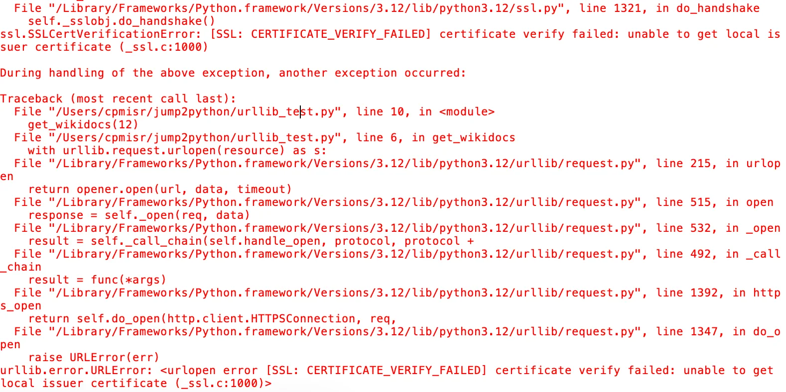
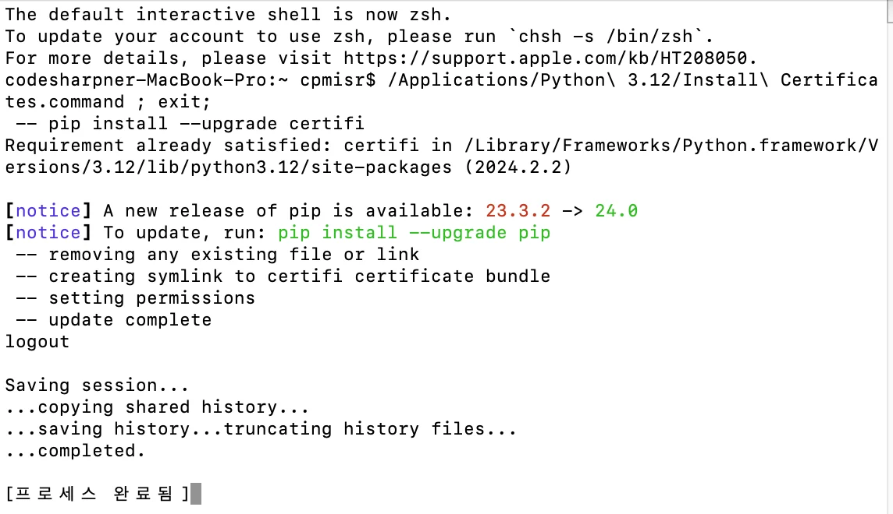
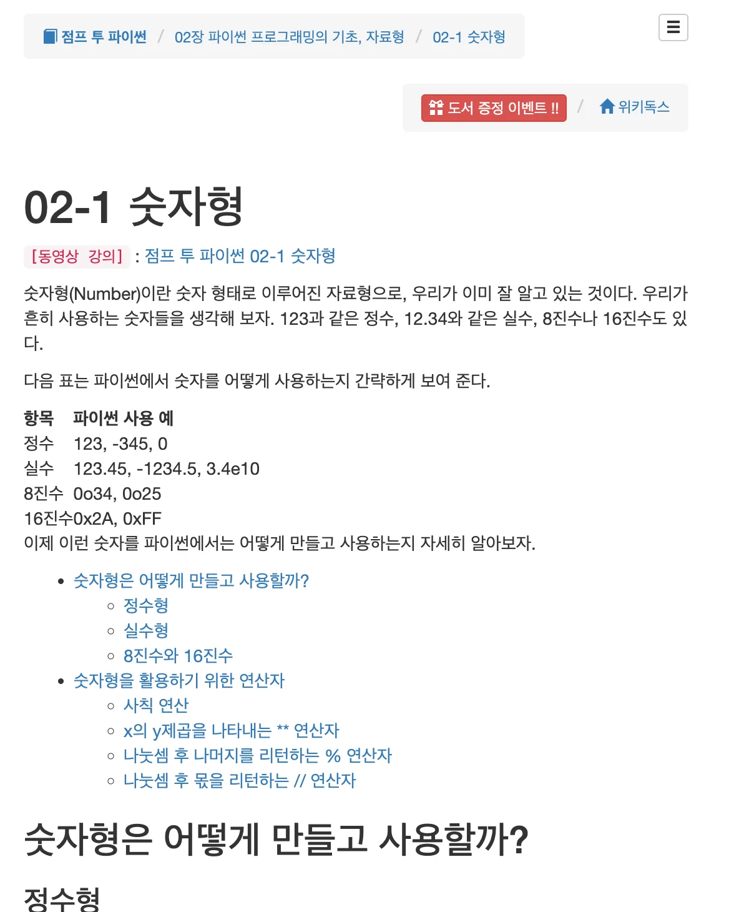

> 작성일: 20240211
> 최근 수정일: 20240211

> OS: mac
> language: python
>     ver: 3.12.1

---

<!-- truncate -->

## 선행지식

### [파이썬 공식 문서 - urllib(10.7 Internet Access 참조)](https://docs.python.org/3/tutorial/stdlib.html#brief-tour-of-the-standard-library)

---

## urllib.request.urlopen()을 통한 웹페이지 불러오기

URL의 읽기, 분석 등에 사용할 수 있는 library인 urllib을 사용한 다음과 같은 코드로 특정 웹페이지를 .html 파일로 저장할 수 있다.

```python
import urllib.request   

def get_wikidocs(page):
    resource = "https://wikidocs.net/{}".format(page)
    with urllib.request.urlopen(resource) as s:
        with open("wikidocs_%s.html" % page, 'wb') as f:
            f.write(s.read())

get_wikidocs(12)
```

## urllib.error.URLError:

### error occurred

위 코드를 실행하면 다음과 같은 에러가 발생한다.

`urllib.error.URLError: <urlopen error [SSL: CERTIFICATE_VERIFY_FAILED] certificate verify failed: unable to get local issuer certificate (_ssl.c:1000)>`

요약하자면 SSL이 <u>CERTIFICATE VERIFY된 SSL</u>이 아니라 <u>self-signed SSL</u>이라 보안상의 문제로 urlopen을 할 수 없다는 것이다.

<figure>



<figcaption>figure 1. An URLError occurred</figcaption>
</figure>

### fix

해결을 위해서는 다음 경로에서 Install Certificates.command 파일을 실행시켜야 한다.

`/Applications/Python 3.12(버전마다 다름)/Install Certificates.command`

<figure>



<figcaption>figure 2. Install Certificates.command</figcaption>
</figure>

<details>
<summary>위 파일은 다음과 같은 코드를 실행한다.</summary>

```python
#!/bin/sh

/Library/Frameworks/Python.framework/Versions/3.12/bin/python3.12 << "EOF"

# install_certifi.py
#
# sample script to install or update a set of default Root Certificates
# for the ssl module.  Uses the certificates provided by the certifi package:
#       https://pypi.org/project/certifi/

import os
import os.path
import ssl
import stat
import subprocess
import sys

STAT_0o775 = ( stat.S_IRUSR | stat.S_IWUSR | stat.S_IXUSR
             | stat.S_IRGRP | stat.S_IWGRP | stat.S_IXGRP
             | stat.S_IROTH |                stat.S_IXOTH )

def main():
    openssl_dir, openssl_cafile = os.path.split(
        ssl.get_default_verify_paths().openssl_cafile)

    print(" -- pip install --upgrade certifi")
    subprocess.check_call([sys.executable,
        "-E", "-s", "-m", "pip", "install", "--upgrade", "certifi"])

    import certifi

    # change working directory to the default SSL directory
    os.chdir(openssl_dir)
    relpath_to_certifi_cafile = os.path.relpath(certifi.where())
    print(" -- removing any existing file or link")
    try:
        os.remove(openssl_cafile)
    except FileNotFoundError:
        pass
    print(" -- creating symlink to certifi certificate bundle")
    os.symlink(relpath_to_certifi_cafile, openssl_cafile)
    print(" -- setting permissions")
    os.chmod(openssl_cafile, STAT_0o775)
    print(" -- update complete")

if __name__ == '__main__':
    main()
EOF
```

</details>

<details>
<summary>오류 더 알아보기</summary>

### 1. python 설치 폴더에는 오류와 관련하여 ReadMe.rtf 파일이 동봉되어 있다.

<details>
<summary>원문</summary>

> ❗ —원문—
> This package will install Python 3.12.1 for macOS 10.9 or later for the following architecture(s): arm64, x86\_64.
>
> <strong>Certificate verification and OpenSSL</strong>
>
>
>
> This package includes its own private copy of OpenSSL 3.0.   The trust certificates in system and user keychains managed by the <em>Keychain Access </em>application and the <em>security</em> command line utility are not used as defaults by the Python ssl module.  A sample command script is included in /Applications/Python 3.12 to install a curated bundle of default root certificates from the third-party certifi package ([https://pypi.org/project/certifi/](https://pypi.org/project/certifi/)).  Double-click on Install Certificates to run it.
>
>
>
> The bundled pip has its own default certificate store for verifying download connections.
>
>
>
> <strong>Install Options</strong>
>
>
>
> You can control some aspects of what is installed by this package. To see the options, click on the Customize button in the Installation Type step of the macOS installer app.  Click on a package name in the list shown to see more information about that option,
>
>
>
> <strong>Using IDLE or other Tk applications</strong>
>
>
>
> This package includes its own private version of Tcl/Tk 8.6. It does not use any system-supplied or third-party supplied versions of Tcl/Tk.
>
>
>
> Due to new security checks on macOS 10.15 Catalina, when launching IDLE macOS may open a window with a message <strong>"Python" would like to access files in your Documents folder</strong>.  This is normal as IDLE uses your <strong>Documents</strong> folder as its default when opening and saving files; you can still choose other locations in the <strong>Open</strong> and <strong>Save</strong> file dialog windows.  Click on the <strong>OK</strong> button to proceed.
>
>
>
> <strong>Apple Silicon Mac support</strong>
>
>
>
> On Apple Silicon Macs, it is possible to run Python either with native ARM64 code or under Intel 64 emulation using Rosetta2. This option might be useful for testing or if binary wheels are not yet available with native ARM64 binaries.  To  easily force Python to run in emulation mode, invoke it from a command line shell with the python3-intel64 command instead of just python3.
>
>
>
> <strong>Other changes</strong>
>
>
>
> For other changes in this release, see the <em>What's new</em> section in the [Documentation Set](https://www.python.org/doc/) for this release and its <em>Release Notes</em> link at [https://www.python.org/downloads/](https://www.python.org/downloads/).

</details>

<details>
<summary>한국어 번역</summary>

> ❗ 이 패키지는 macOS 10.9 이상용 Python 3.12.1을 다음 아키텍처에 설치합니다: arm64, x86\_64.
>
> 인증서 확인 및 OpenSSL
>
>
>
> 이 패키지에는 OpenSSL 3.0의 자체 비공개 복사본이 포함되어 있습니다.   키체인 액세스 애플리케이션 및 보안 명령줄 유틸리티에서 관리하는 시스템 및 사용자 키체인의 신뢰 인증서는 Python ssl 모듈에서 기본값으로 사용되지 않습니다.  타사 인증 패키지([https://pypi.org/project/certifi/](https://pypi.org/project/certifi/))에서 선별된 기본 루트 인증서 번들을 설치하기 위한 샘플 명령 스크립트가 /Applications/Python 3.12에 포함되어 있습니다.  인증서 설치를 두 번 클릭하여 실행합니다.
>
>
>
> 번들된 pip에는 다운로드 연결을 확인하기 위한 자체 기본 인증서 저장소가 있습니다.
>
>
>
> 설치 옵션
>
>
>
> 이 패키지로 설치되는 항목의 일부 측면을 제어할 수 있습니다. 옵션을 보려면 macOS 설치 관리자 앱의 설치 유형 단계에서 사용자 지정 버튼을 클릭합니다.  표시된 목록에서 패키지 이름을 클릭하면 해당 옵션에 대한 자세한 정보를 볼 수 있습니다,
>
>
>
> IDLE 또는 기타 Tk 애플리케이션 사용
>
>
>
> 이 패키지에는 자체 비공개 버전의 Tcl/Tk 8.6이 포함되어 있습니다. 시스템 제공 또는 타사에서 제공한 Tcl/Tk 버전을 사용하지 않습니다.
>
>
>
> macOS 10.15 Catalina의 새로운 보안 검사로 인해 IDLE을 실행할 때 "Python"이 문서 폴더의 파일에 액세스하려고 한다는 메시지가 표시되는 창이 열릴 수 있습니다.  IDLE은 파일을 열고 저장할 때 문서 폴더를 기본값으로 사용하므로 이는 정상이며, 파일 열기 및 저장 대화 상자 창에서 다른 위치를 선택할 수 있습니다.  계속하려면 확인 버튼을 클릭합니다.
>
>
>
> Apple Silicon Mac 지원
>
>
>
> Apple Silicon Mac에서는 네이티브 ARM64 코드를 사용하거나 Rosetta2를 사용하여 Intel 64 에뮬레이션에서 Python을 실행할 수 있습니다. 이 옵션은 네이티브 ARM64 바이너리를 아직 사용할 수 없는 경우 또는 테스트에 유용할 수 있습니다.  Python을 에뮬레이션 모드에서 실행하도록 쉽게 강제하려면 명령줄 셸에서 python3 대신 python3-intel64 명령을 사용하여 호출하세요.
>
>
>
> 기타 변경 사항
>
>
>
> 이 릴리스의 기타 변경 사항은 이 릴리스에 대한 문서 세트의 새로운 기능 섹션과 해당 릴리스 노트 링크([https://www.python.org/downloads/](https://www.python.org/downloads/))를 참조하세요.
>
>
>
> Translated with [DeepL.com](http://deepl.com/) (free version)

</details>

### 2. 오류가 발생하는 이유

- python에서 사용하는 urllib.request는 ‘Pyppeteer’이라는 library를 통하여 웹 크롤링을 한다.

- Pyppeteer은 Chromium 기반 웹브라우저를 제어할 수 있다.
  (google에서 관리하는 node.js용 Puppeteer의 unofiicial python port가 Pyppeteer이다. 즉, ReadMe.rtf에서 언급된 third-party certifi package)

- Python installation에 SSL certificates가 없기 때문에 ‘Pyppeteer’가 chrome을 통한 스크랩 중에 오류가 발생한다.

</details>

## 에러 해결 후 urllib.request.urlopen() 결과

<figure>


<figcaption>figure 3. 코드 실행 결과로 생성된 wikidocs\_12.html</figcaption>
</figure>

<figure>



<figcaption>figure 4. 생성된 html 파일의 내용</figcaption>
</figure>

---

## reference.

[점프 투 파이썬 05-6 표준 라이브러리](https://wikidocs.net/33#urllib)

---

[인블로그 원문](https://codesharpener.inblog.io/%ED%8C%8C%EC%9D%B4%EC%8D%AC-%EC%9B%B9-%ED%81%AC%EB%A1%A4%EB%A7%81-%EC%A4%91-%EC%98%A4%EB%A5%98-%EB%B0%9C%EC%83%9D-%EC%9B%90%EC%9D%B8%EA%B3%BC-%ED%95%B4%EA%B2%B0-15952)
