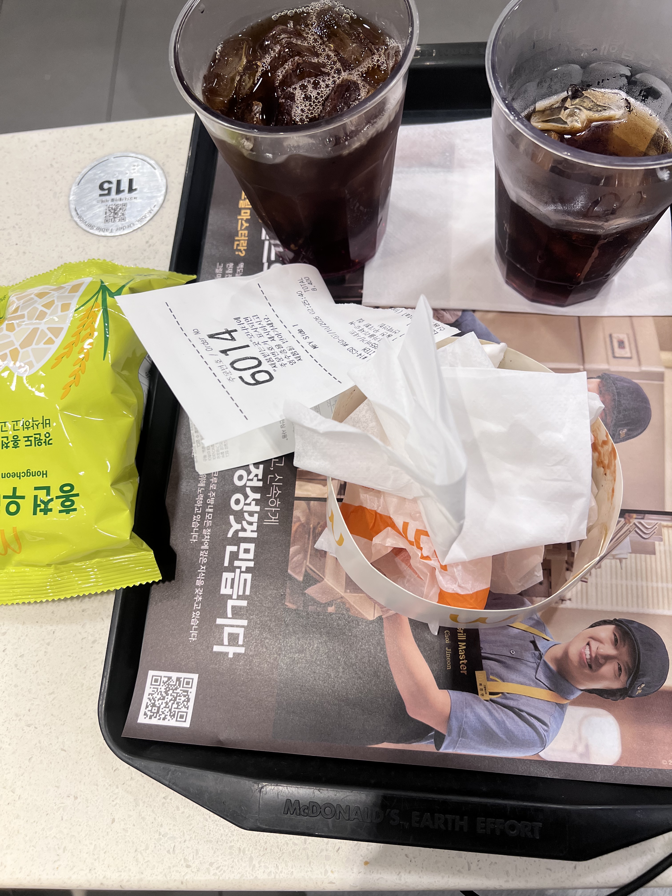
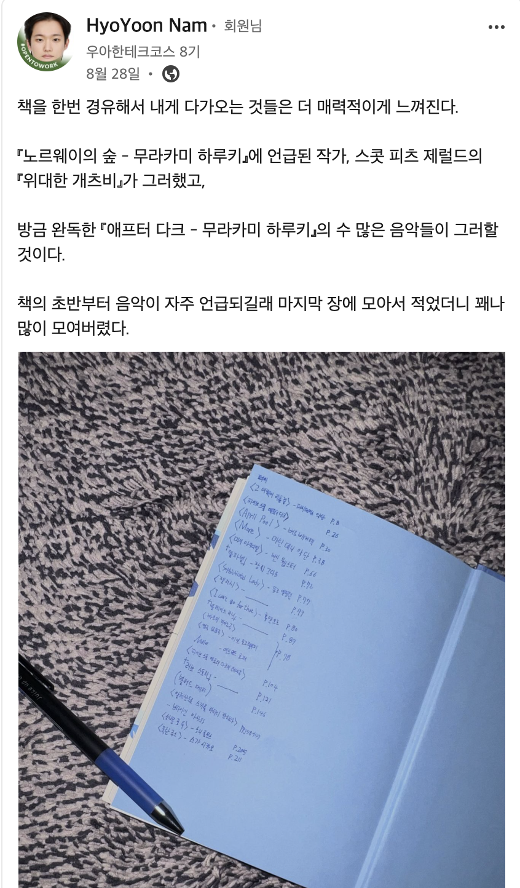
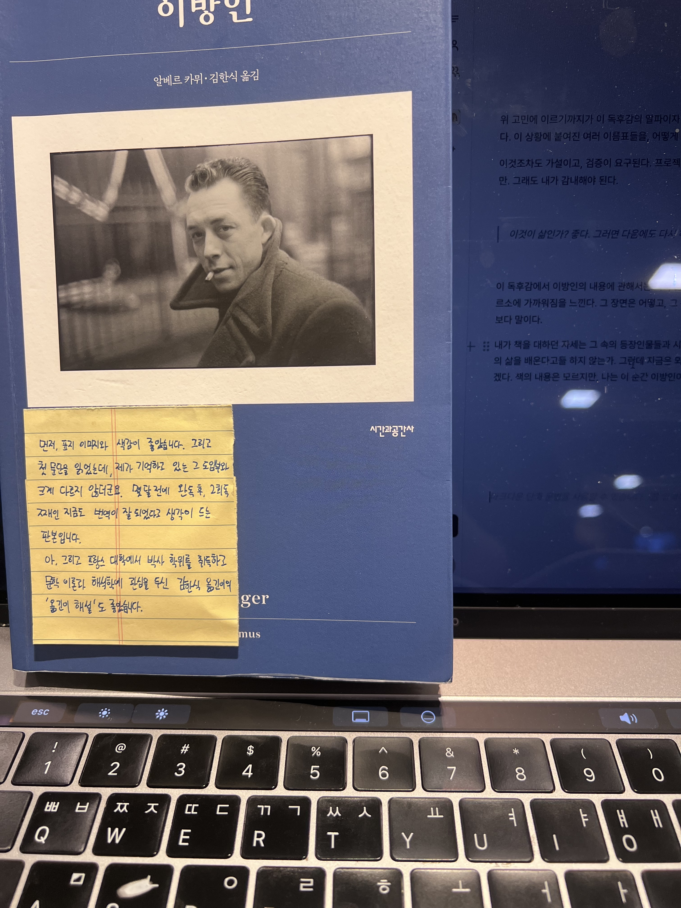

사실 함께하지 못한다. 내가 무자비하게 먹어치웠기 때문. 아니, 사실 먹기 전보다 나와 더 함께인 걸까? *아무래도 상관없겠다.*

<!-- truncate -->

지금 시각은 2시 50분이다. 그리고 10월 7일 수요일이다. 장소는 수내역 맥도날드. 24시간 프랜차이즈가 있다는 건 집이 아니고서도 언제라도 머무를 수 있다는, 그런 안정감을 내게 준다.

나는 왜 이 시간에 깨어있으며, 그것도 아늑한 집을 놔두고서는, 지금 여기에 있는 걸까? 이 글에서 나를 만났듯이, 이방인 독후감을 쓰러 왔다. 이왕 새벽내 작업을 할 거라면, 허기도 채우고 공간 분위기도 바꾸면 좋았겠다는 판단이었다.

사실 이방인 독후감을 쓰려고 한 건 아니다. 물론, 써야만 했다. 최근 이방인 책을 읽고 크루들과 이야기를 나눈 적이 있고, 그 후속 활동으로 독후감을 써오기로 했으니까. 이 글을 적기 전, 내가 하고 있던 작업은 마이리얼트립(이하 '마리트') 신입 공채 지원을 위한 활동 정리였다.

그런데 문득 이런 생각이 들었다.

* 마리트 지원을 위해 지난 우테코 활동에서의 활동을 정리하니, 마리트와 우테코 프로젝트에서 지향하는 바가 '문제 중심의 해결'로 비슷하다.
* (입사한다면) 내가 지금 좋아하는 분야를 마리트에서 어떻게 녹여낼까?
  * 책이 좋다. 책에 나오는 영화나 음악, 다른 책, 음식과 장소는 내게 더 많은 호감을 준다. 주로 일본 문학에서 더욱 그러한데, 일본 애니메이션에 나오는 장소를 찾아 다니며 사진찍는 것이 유행하듯, 책에 나오는 장소를 방문하거나 음식을 먹을 수 있게 동선을 계획해주면 어떨까? (음악이 많긴 했지만) 무라카미 하루키의 애프터다크에 나오는 것들을 책 뒷면에 적으며 읽었을 때가 기억난다. 재미도 있고, 인생을 살아가며 나만의 위키를 만들어 보고 싶다는 생각이 들었다.

* 달리기가 좋다. 해외여행을 좋아하지 않고, 싫어하지도 않는. 별 감흥없는 나인데, 최근에는 해외에서 러닝하는 걸 상상하면 심장이 벅차오르기까지 한다. 그런데 '좋은 달리기 코스'는 계획하기 어렵다. 긴 거리를 달릴 계획일 때 더욱 그러한데(운동장 트랙만 뱅글뱅글 돌면 재미가 떨어지니까..) 국내에서도 쉽지 않은 일이라 해외 나가서는 더 어려울 거라 생각한다. 사용자들이 안심하고 러닝할 수 있도록 동선을 상세하게 계획해주면 어떨까?

위에서 주저리주저리 적었듯, 마리트의 방향성 속에서 내가 재미있게 지낼 수 있다는 기대가 컸고 우테코에서 의식적으로 훈련하던 가설 계획, 데이터 기반 의사결정, 분야를 가리지 않고 처음부터 끝까지 해보는 경험까지도 마리트를 위해 내게 주어졌던 일들이라고까지 느껴진다.

그런데, 이런 생각도 든다. 지금 내가 적는 경험을, 다른 기업에서도 알아봐줄까? 가치로 인정해줄까? 다른 백엔드 크루들이 기업에 지원하기 위해 준비하는 방향과는 차이가 있네?

> *나는, 취업 시장에서의 이방인인가?*

위 고민에 이르기까지가 이 독후감의 알파이자 오메가이다. 고민이기도 하고, 불안이기도 하며, 도전이기도 하다. 이 상황에 붙여진 여러 이름표들을, 어떻게 풀어낼지는 모르겠다.

이것조차도 가설이고, 검증이 요구된다. 프로젝트나 설문에서의 가설과는 달리, 그보다 훨씬, 무거운 것이지만. 그래도 내가 감내해야 된다.

> *이것이 삶인가? 좋다. 그러면 다음에도 다시 하겠다.*

이 독후감에서 이방인의 내용에 관해서는 적지 않았지만, 그 모든 내용이 내 단기 기억 공간에 있을 때보다 뫼르소에 가까워짐을 느낀다. 그 장면은 어떻고, 그 문장은 뭘 표방하고, 이런 생각을 하며 책 끄트머리에 적는 것보다 말이다.

내가 책을 대하던 자세는 그 속의 등장인물들과 시대를 느끼고, 향유햐는 것이었다. 책으로 하여금 다른 인물의 삶을 배운다고들 하지 않는가. 그런데 지금은 뫼르소의 삶으로부터라면, 되려 멀어졌다. 책의 내용은 모르겠다. 책의 내용은 모르지만, 나는 이 순간 이방인이 된다.

### *3시 33분. 이 글은 끝난다.*

---

[리로그 원문](https://www.rilog.kr/@rudevico/posts/155)
