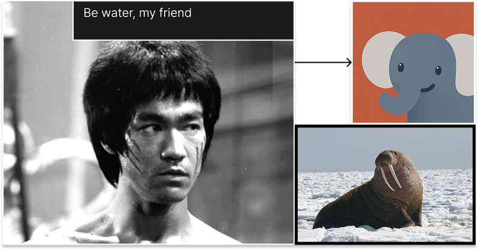
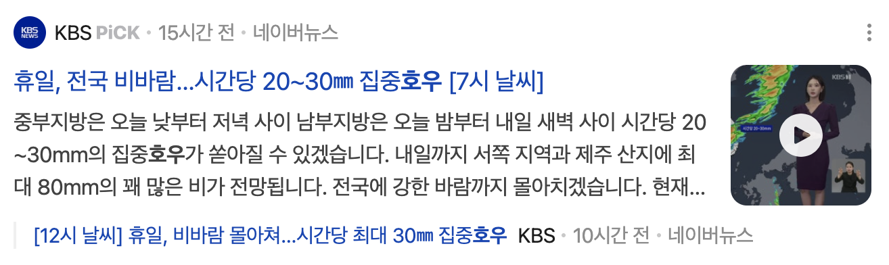
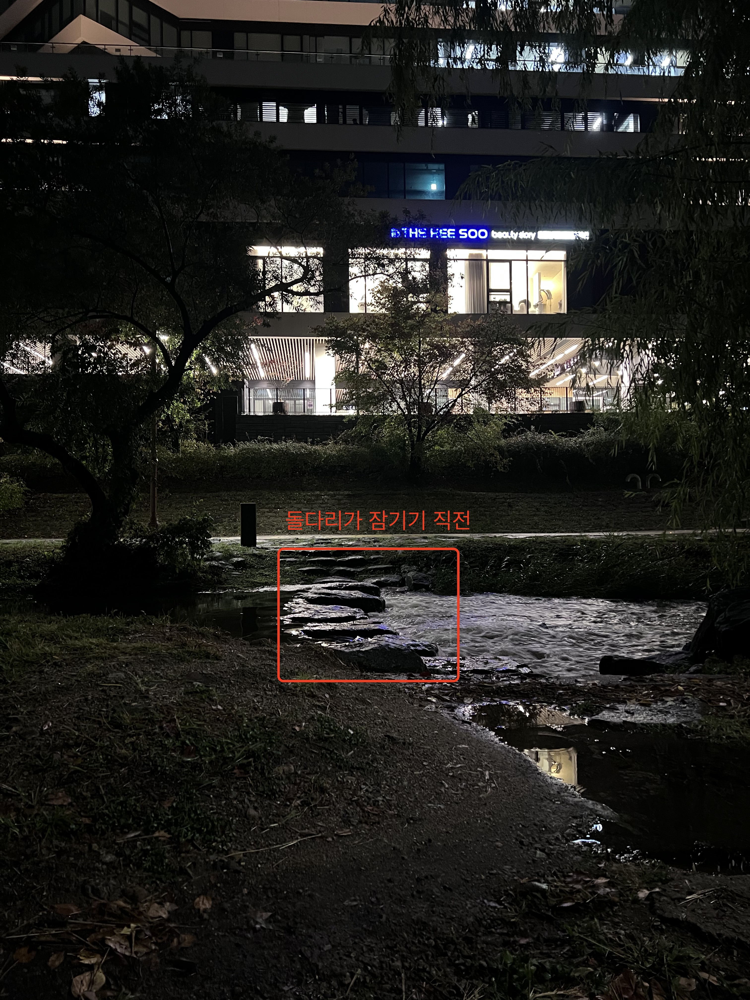
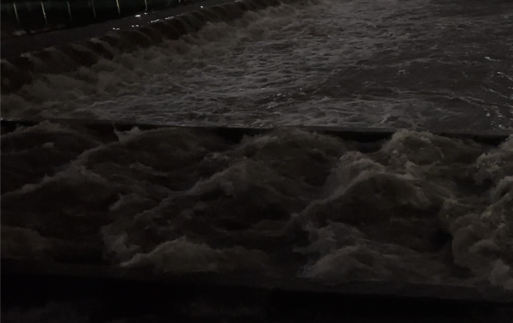
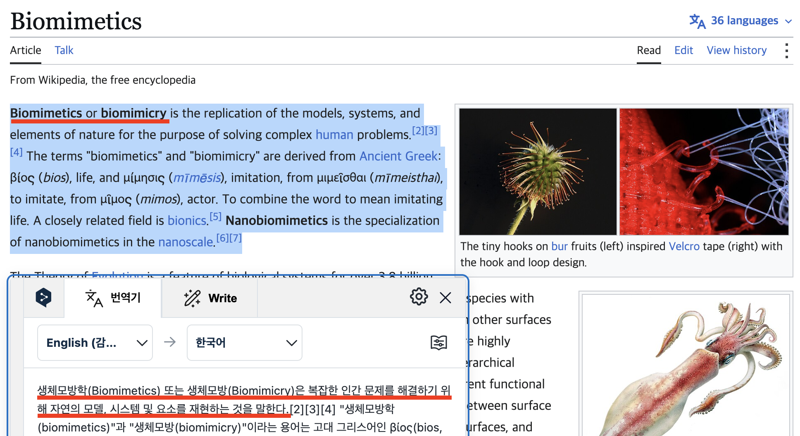
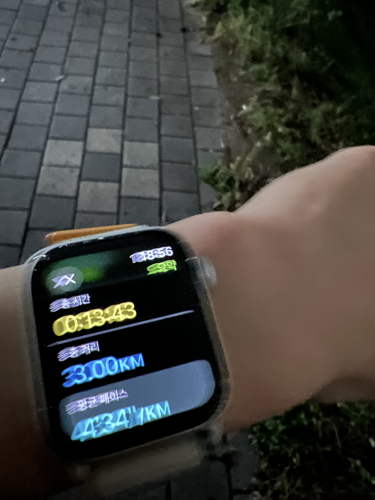
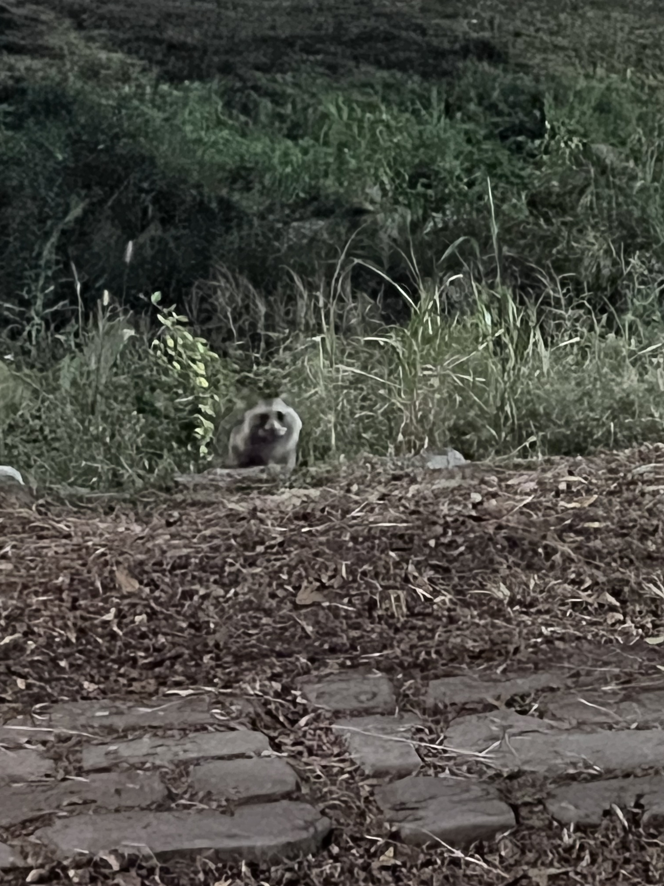
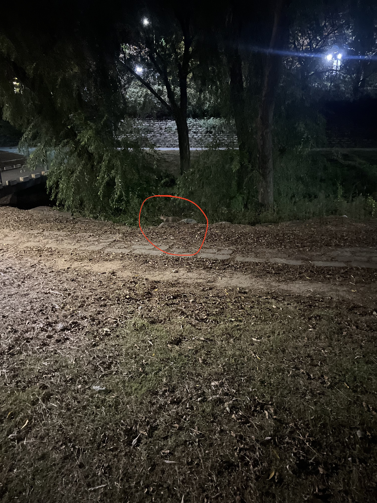
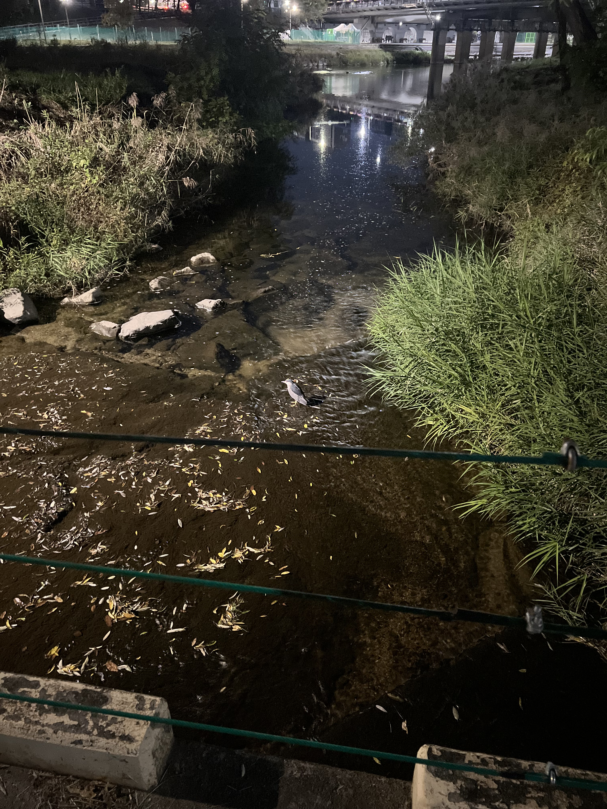
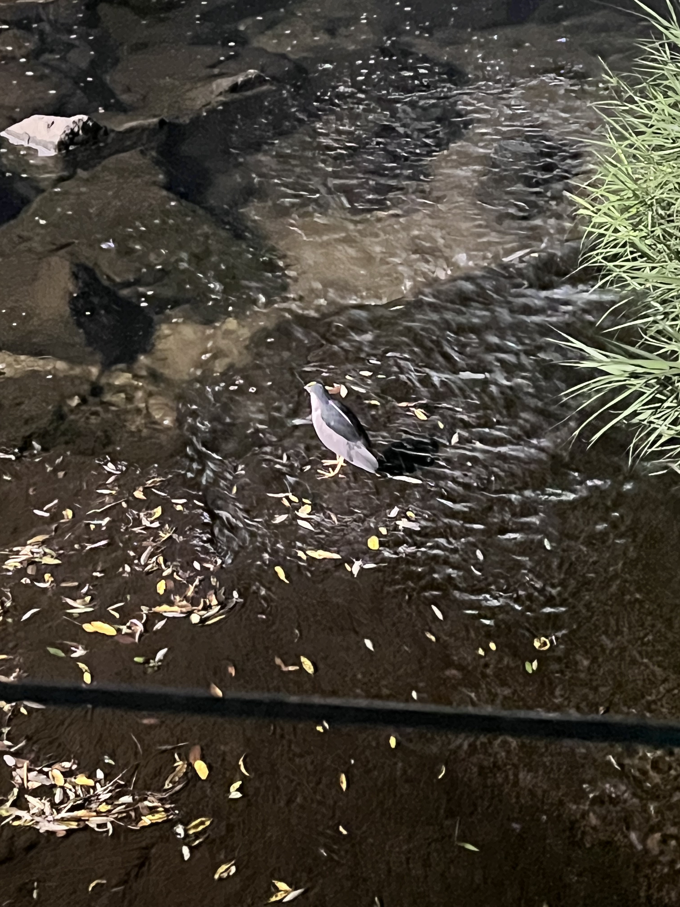

## 물이 되기

<figure>

<figcaption>사진 1. 서울/경기 호우주의보 뉴스 기사(1) - YTN</figcaption>
</figure>

<figure>

<figcaption>사진 2. 서울/경기 호우주의보 뉴스 기사(2) - KBS</figcaption>
</figure>

*가을비가, 그것도 꽤나 세찬 가을비가 내리는 26년의 일요일이다.* 그래도 오후 6시 즈음에는 비가 그쳐가길래 주섬주섬 달릴 준비를 했다.

<!-- truncate -->

비로 인해서 달라진 풍경은 탄천의 수위였는데, 하천의 양 옆을 잇는 돌다리가 잠기기 직전까지 물이 차올랐다.

<figure>

<figcaption>사진 3. 물에 잠기기 직전인 돌다리</figcaption>
</figure>

이대로 계속해서 물을 받아내기에는 무리라고 생각했는지 하천은 유속을 빠르게 만들어 저 멀리 어딘가로 물을 흘려보내고 있었다.

<figure>

<figcaption>사진 4. 엄청난 양과 속도로 하천을 흐르는 물</figcaption>
</figure>

'자연은 필요에 따라 잔잔히 흐르기도, 속도를 내기도 하는구나' 감탄하는 와중에 어렴풋이 기억에 있던 '자연을 모방하여 만들어진 기술이 많다'는 말이 생각났다.

> 결국 인생에서 여유를 가지고 삶이 중요하지만, 바빠야 할 때는 내 인생의 유속도 잠시 빠르게 할 필요가 있겠구나. 물처럼.

그래서 나는 물이 되기로 했고, 우테코 활동 기간이 얼마 남지 않은 지금에는 상당히 빠른 유속을 만들어 낼 필요가 있겠다.

<figure>

<figcaption>사진 5. 생체모방학(Biomimetics) - wikipedia</figcaption>
</figure>

<figure>

<figcaption>사진 6. 오늘의 달리기록</figcaption>
</figure>

### 탄천 친구들

지난 번에 달릴 때 너구리랑 새를 봤는데 오늘 잘 버텨냈을까..?

<figure>

<figcaption>사진 7. 너구리A</figcaption>
</figure>

<figure>

<figcaption>사진 8. 너구리B</figcaption>
</figure>

<figure>

<figcaption>사진 9. (자고 있는?) 새</figcaption>
</figure>

<figure>

<figcaption>사진 10. 새 확대</figcaption>
</figure>

## 베이컨 수필집 이야기 - 역경 | 문예출판사

이번 수필에서는 역경을 즐기는 법을 제시한다. 비슷한 문장이 많아 이를 정리하는 것으로 마무리한다.

> 번성에 속하는 좋은 것은 탐낼 만한 것이지만, 역경에 속하는 좋은 것은 찬양할 만한 것 - 세네카

요즘 <strong>[&lt;세네카, 오늘을 빼앗기고 있는 당신에게&gt;](https://www.yes24.com/product/goods/192474512)</strong>가 유행하던데 프랜시스 베이컨도 언급하길래 신기했다.

> 분명히 기적이 자연 위에 군림하는 것이라면, 기적은 대체로 역경 속에서 나타난다.

> 번성은 미덕의 절제요, 역경의 미덕은 인내다. 인내가 도덕적으로 훨씬 영웅적인 미덕이다.

> 번성은 구약에서 말하는 축복이요, 역경은 신약에서 말하는 축복이다. 이 역경이 더 큰 은혜를 약속해주고, 신의 가호를 더 선명하게 계시해준다.

> 역경 속이라고 위안과 희망이 없는 것이 아니다. 재봉일이나 수예에서 슬프고 장중한 바탕에 경쾌한 무늬를 넣는 것이, 밝은 바탕에 어둡고 침울한 무늬를 넣는 것보다 훨씬 즐겁다.

> 번성은 악덕을 가장 잘 드러내지만, 역경은 미덕을 가장 잘 드러낸다.

### 내가 몰랐던 표현들

* **성령:** *holy spirit, holy ghost.* 기독교에서 사용하는 단어인데, 나로써는 설명을 봐도 이해가 힘들다. 외국에서나 한국에서나 기독교인들도 헷갈려하는 글도 많이 보인다.

> 또한 성령의 붓끝은 솔로몬의 영화보다도 욥의 고난을 그리는 데 더욱 큰 힘을 들이고 있다.

* **수예:** 손(또는 단순한 도구 정도만 사용하여)으로 무언가를 만드는 것.

> 재봉일이나 수예에서 슬프고 장중한 바탕에 경쾌한 무늬를 넣는 것이...

---

[리로그 원문](https://www.rilog.kr/@homo_scribens/posts/198)
