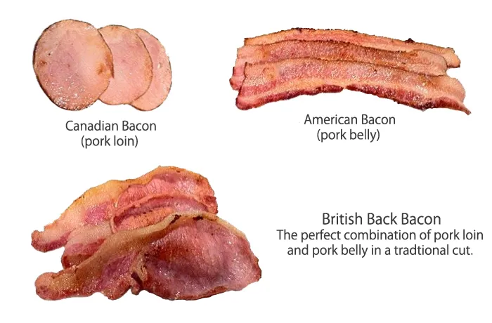

5일 정도 전이었을까, 문예 출판사에서 출간한 프랜시스 베이컨의 수필집을 샀다. `아는 것이 힘이다`라는 명언으로 유명한데, 나도 명언 정도만 알고 있을 뿐, 자세히 알지 못해 우연히 책을 만난 김에 알아가고 싶었음이 그 이유다. 그리고 약 270 페이지 가량의 책에 약 60권의 주제가 실릴 정도로 각 주제에 대한 분량이 적어 '하루 1주제 챌린지'처럼 소박한 취미가 될 수 있겠다는 생각이 두 번째 이유다.

<!-- truncate -->

<figure>

<figcaption>https://www.yes24.com/product/goods/147564050</figcaption>
</figure>

## 남에게 화를 낼 까닭이 없다?

> *남에게 해를 끼치는 것이 좋아서 해를 끼치는 사람이 어디 있겠는가? 오로지 그렇게 함으로써 이득과 쾌락과 명예 따위를 얻어내려고 그러는 것이 아닌가? 그렇다면 사람들이 나보다도 자기 자신을 더 사랑한다 하여 화를 낼 까닭이 무엇이겠는가?* - 복수, 프랜시스 베이컨

이 주장을 보니 '기대가 없으면 화도 나지 않는다'가 떠오른다. 예를 들어 상대의 나쁜 습관을 '그거 하면 네가 손해지, 내 손해냐~' 하면서 피드백 해주지 않는 건 오히려 소통 부재가 된다. 서로의 성장을 위한다면 피드백 함이 좋은 거 아닌가..?

책에서는 '화는 내지 말고 차분히 잘 말하라'처럼 대안을 제시하는 게 아니라 '화를 낼 필요가 없다'만 말하고 있어서 '화를 낸다'는 표현에 결국 angry하게 상대에게 뭐라고 하기, normal하게 피드백하기 등이 포함된다고 보인다. 이걸 전제로 하면 위 문단에서 말한 소통 부재로 인해 결국 서로에게 해가 되는 거 아닌가 싶네..

## 내가 몰랐던 표현들

* 고매하다: 인격이나 품성, 학식, 재질 따위가 높고 빼어나다.

> 욥의 정신은 이에 비하여 고매한 목소리를 가진다.

* 잠언: 성경의 제 24 / 20권. 상당수의 구절을 솔로몬이 직접 지었거나 편집했다고 알려져 있다. 언어별 명칭은 다음과 같다. (내가 해석하기로는 격언, 조언 정도로 생각된다.)

<table>
  <tbody>
    <tr><th scope="row">히브리어</th><td>משלי (Mishlei)</td></tr>
    <tr><th scope="row">그리스어</th><td>Παροιμίαι (Paroimiai)</td></tr>
    <tr><th scope="row">라틴어</th><td>Proverbia</td></tr>
    <tr><th scope="row">영어</th><td>Proverbs</td></tr>
    <tr><th scope="row">한국어</th><td>잠언(箴言) (바늘로 찌르는 말)</td></tr>
  </tbody>
</table>

## 피드백 to rilog

### 1. 표가 글머리 하위 영역으로 들어가지 않아요

* 글머리
  * 글머리 하위 영역
* 글머리

> 인용은 글머리 하위 영역으로 됨

* 글머리

<table>
  <tbody>
    <tr><td>표는 글머리 하위 영역이 안 됨</td><td></td></tr>
    <tr><td></td><td></td></tr>
  </tbody>
</table>

### 2. 명령어 검색에서 table의 결과가 없어요

`/table` 치면 표가 나올 거라 기대하는데 그렇지 않음.

---

[리로그 원문](https://www.rilog.kr/@homo_scribens/posts/195)
