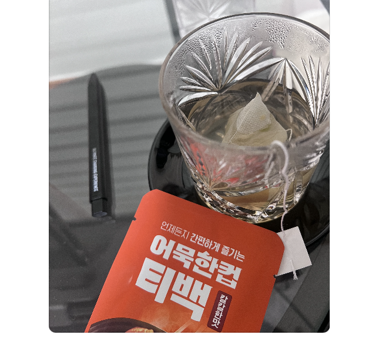

오늘 하루의 마무리는 어묵 티백과 함께 한다. 사실 우테코 사람이라면 익숙한 사실이겠지만, 코끼리는 어묵을, 특히 어묵탕을 좋아하지 않는다.

하지만 오늘은 어묵 티백과 함께 마무리하고픈, 그런 날이다. 코끼리는 사실 어묵을 좋아하는 걸까?

<!-- truncate -->

***

> 기억에 남고, 공적을 쌓고, 고귀한 일을 행하는 것은 인간에게 고유한 것이다. 그리하여 가장 고귀한 업적과 기틀은 자식을 가지지 않은 사람들에게서 비롯된다. 육체의 형상을 남기지 못하므로 정신의 형상을 표현하려고 노력하기 때문이다.

'대를 잇는다'는 동물 본능에서 출발하여 자손(육체의 형상)으로 본능을 충족하지 못한다면 정신의 형상을 남기려고 노력한다는 접근이 재밌었다.

자식을 낳는다는 건 그 자체로 고귀하고, 삶의 이유나 목표가 바뀌는 사건인데, 이전과 삶의 시간 비율이 바뀌는 건 사실이지 않는가? 육체적으로나 직장에서나 커리어가 하이를 찍어갈 때 즈음에 결혼하게 되는 경우가 많은데 결혼을 제쳐두고 일/연구에 집중한다면, 여기서 말하는 정신의 형상이 더 남겨지긴 하겠다.

그런데 (이 경우에는 결혼의) 때를 기다리다가는 점점 '최상의 때'를 찾기 위한 욕심이 커지기 때문에 준비되지 않았다고 느껴지는 때에 결혼하는 것도 좋지 않을까..

> 부모는 자녀들이 취해야 할 직업과 진로를 일찍 결정해주는 것이 바람직하다. 나이가 어릴수록 유연성도 크기 때문이다. 자식이 하고 싶은 대로 하도록 내버려두는 것이 좋다고 생각하여 자녀들의 취향을 지나치게 존중하는 것은 좋지 않다. 자녀의 취향이나 소질이 특출한 것이라면, 물론 그들의 뜻을 꺾지 않는 것이 좋다.

부모가 자녀의 직업과 진로를 일찍 결정해줘야 빠르게 접해보고, 안 맞았을 때 다른 걸 알아보기에 리스크가 적다는 건가?(유연성이 크다고 하길래..) 이번 내용은 어렵다.

---

[리로그 원문](https://www.rilog.kr/@homo_scribens/posts/217)
