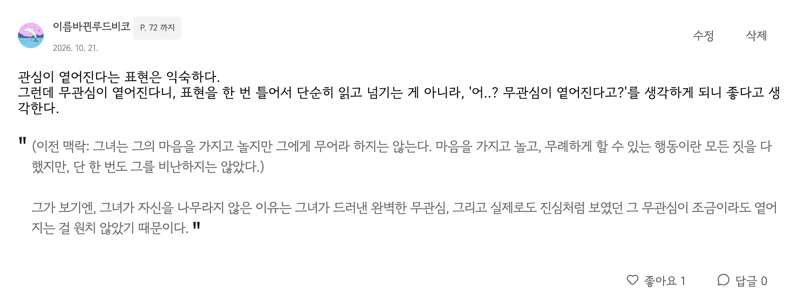
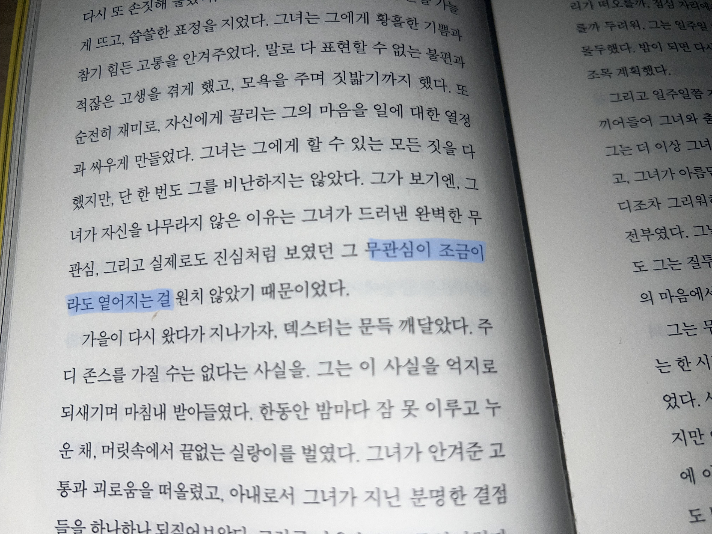

> *그가 보기엔, 그녀가 자신을 나무라지 않은 이유는 그녀가 드러낸 완벽한 무관심, 그리고 실제로도 진심처럼 보였던 그 무관심이 조금이라도 옅어지는 걸 원치 않았기 때문이다.* - &lt;겨울꿈 - 스콧 F. 피츠제럴드&gt;

<!-- truncate -->

나는 책을 음미하며 읽지 않는다. 그 책을 온전히 이해하려 하지 않고 느낌대로 슥슥... 읽는 편인데, 그런데 내 읽어감이 멈칫한 순간이 있다.

〰️〰️

**무관심이 옅어진다**는 표현과 만난 때인데, 인상깊어서 [감상을 남겨놓기까지 했다](https://chaekchaek.com/download).

<figure>

<figcaption>옅어지는 무관심에 내가 남긴 감상 - on the chaekchaek</figcaption>
</figure>

무관심하게, 또는 관심이 없다는 사실조차 인지하지 않는 수준으로 대하던 대상이 있다고 하자. 가령 음식점에서 에어컨 바람에 흩날리는 휴지라던가, 책상 옆 바닥에 있는 회색 먼지 뭉치라던가, 그런 것들 말이다.

하지만 그 무관심이 옅어지는 순간이 있다. 휴지의 흩날림이 갑자기 거슬릴 수도, 누군가 걸어가며 생긴 바람에 휘잉-하고 움직이는 먼지에 시선을 빼앗길 수도...

〰️〰️

사람에게도 마찬가지로, 관심이 생기는 게 아니라 무관심이 옅어지는 건 아닐까.

 〰️〰️

<figure>

<figcaption>.옅어지는 무관심 | 마침.</figcaption>
</figure>

---

[리로그 원문](https://www.rilog.kr/@homo_scribens/posts/231)
