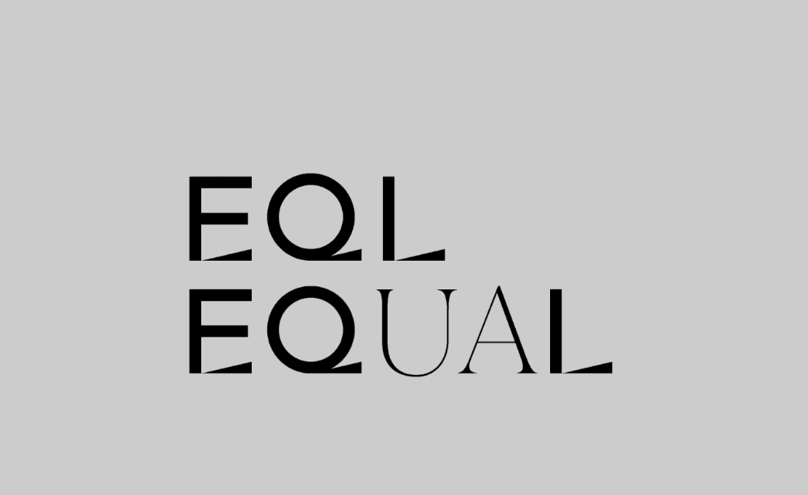

> *처자식을 가진 자는 운명의 손에 인질로 넘어간 자다. 좋은 일이든 나쁜 일이든 큰일을 하려는 사람에게 처자식은 큰 방해가 되기 때문이다.* - [&lt;결혼과 독신 생활 | 프랜시스 베이컨 | 문예출판사&gt;](https://www.yes24.com/product/goods/147564050)

상당히 도발적인 발언이다. 아이가 없다면 그만큼 일에 더 집중할까? 아이에 대한 책임감을 원동력으로 일에 더 집중하게 되지는 않을까?

<!-- truncate -->

대학교 시험기간, '밤을 새자'는 다짐을 하고 도서관에 들어선다. 저녁 10시에 들어가니, 다음 날 오후 2시에 있는 컴퓨터 시뮬레이션 수업까지는 무려 16시간이 남는다. 3시간마다 한 개 챕터씩만 끝내면 충분하다.

〰️〰️

밤을 지새움으로써 생겨난 16시간은 온전히 내 시간일까?

〰️〰️

아이가 없어서 생기는 시간은 온전히 다 집중할 수 있는 시간일까..? 그렇지 않다. 위에서 말했듯 아이로 인해 오히려 더 깊은 몰입과 집중을 한 덕분에 일을 잘 해낼 수도 있다. 물론 신생아 때여서 아이가 시도때도 없이 깨고, 자고, 울고, 보채고 하느라 수면 패턴이 완전히 망가진다면... 힘들겠지만서도.

아이를 좋아하는 편에 속하면서도 "처자식이 필요하다"라는 생각을 의식적으로 하지는 않는다. 아이라는 것도 흘러가는 대로 지내다 보면, 자연스레 인생의 동반자가 한 명 늘어나는 거 아닐까?

아이와 함께 하더라도 부모이기보다는 하나의 동등한 인격체, 같으면서도 완전히 다른 삶을 살고 있는 또 다른 인간으로 함께 하고 싶다. 흔히 표현되는 '친구같은 부모'와는 또 다른 느낌..?

〰️〰️

부모 | 자식 | 연인 | 친구 | 스승

.다르면서도 다를 바 없다.

〰️〰️

---

[리로그 원문](https://www.rilog.kr/@homo_scribens/posts/249)
