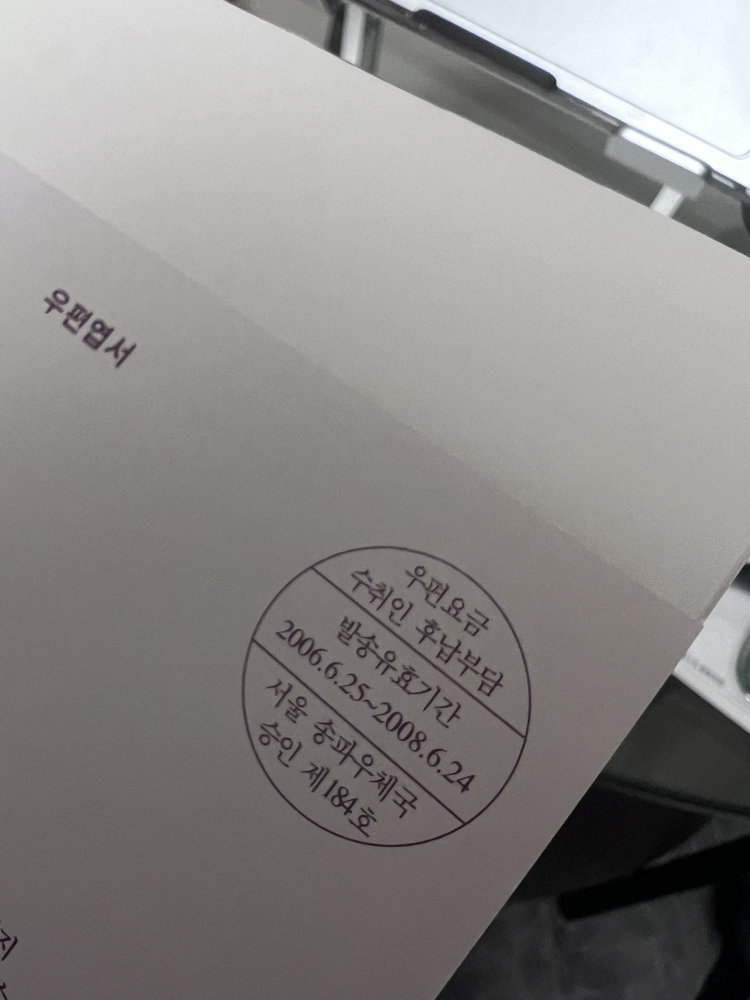
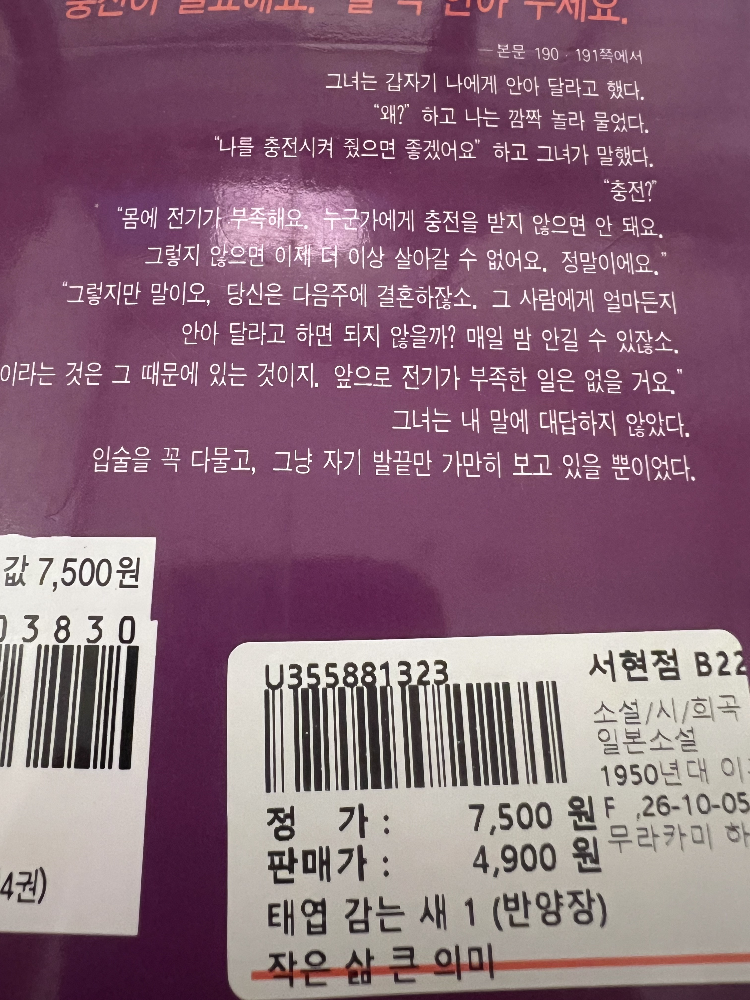
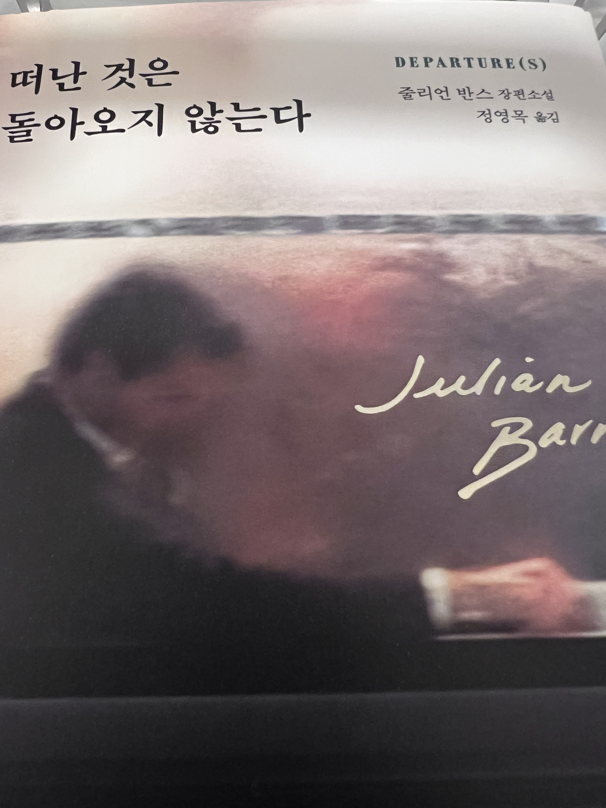

## 책 샀어요.

책을 샀다. `<태엽 감는 새 1 - 무라카미 하루키>`를..

<!-- truncate -->

<figure>

<figcaption>알라딘 중고서점에서 구매한 &lt;태엽 감는 새 1 - 무라카미 하루키&gt;</figcaption>
</figure>

알라딘 중고서점에서 샀더니 4,900원인데 너무 저렴하지 않은가..? 그냥 기분이 좋았다. 나를 더 기분좋게 하는 건, **숙성된 책**이라는 점.

<figure>

<figcaption>2008년이 만료인 우편엽서가 책에 동봉되어 있다..</figcaption>
</figure>

아, 그리고 패브릭 북커버도 샀다. 10800원인가..?

## 그런데...

여기서 문제가 발생한다. 계산대에서 바코드 찍는 소리가 두 번, 점원이 내게 말한다.

> "20,000원 이상 구매하시면 3,000원 할인인데 그대로 결제할까요?"

지난 번에도 같은 상황이 있었다. 그때는 "더 구매해서 할인받는 것이, 할인받지 않는 것보다 손해다"라는 생각으로

> "그냥 결제해 주세요."

라고 말한 뒤 집으로 향했다.

## 그런데 왜..?

왜 오늘은

> "아, 그럼 더 둘러볼게요."

라는 말이 나왔을까..?

그렇게 구매 가격을 채우기 위한 책 탐방이 시작되었고, 이왕 구매할 책 진짜 관심가는 책을 고르고자 영미 문학, 일본 문학, 교양 과학, 민음사 세계문학전집, ... 도서 코너 여기저기로 옮겨 다녔다.

그런데... 보이질 않는다. 마음 끌리는 책이 안 보인다.

알라딘 내부는 덥다.. 긴팔 + 얇은 패딩 + 트렌치 코트를 입고 있었다. 트렌치 코트는 이미 내 팔에 걸쳐진 지 오래다. 패딩까지 가세하면 팔이 너무 힘들까 몸에서 반쯤 벗은 채 휘날리며 다니고 있었다.

그래서 더위도 반쯤 올라온다.. 팔이 무거우니 몸은 힘들어진다. 그런데 책이 안 보인다... 이미 책 찾기에 10분 이상 매몰비용이 발생. 이제 패딩까지 온전히 벗고 조금은 시원하게 둘러본다. 그런데 이미 몸은 피로를 인지했다.

그렇게.... 급 피로에 찌들어버리고 `<떠난 것은 돌아오지 않는다 - 줄리언 반스>`를 골라 집으로 터덜터덜 왔다.

<figure>

<figcaption>겨우 고른 책. &lt;떠나간 것은 돌아오지 않는다 - 줄리언 반스&gt;</figcaption>
</figure>

내가 책을 고를 땐 제목과 작가의 이름을 보고 직관적으로 끌리는 무언가가 있어야 된다. 내게 있어 멋있게 느껴져야 된다. 이 책은 제목이 너무 내 스타일이라 예전부터 찜해두긴 했었다. 왜이리 늦게 눈에 보였을까나...?

사실 이 글을 적기 시작할 때까지만 해도 되게 '**책 헛사러 갔다**'는 생각까지 들었는데, 막상 두 개의 책을 보니 마음이 좋다. 역시 감정은 마무리하기 나름..?

---

[리로그 원문](https://www.rilog.kr/@homo_scribens/posts/264)
