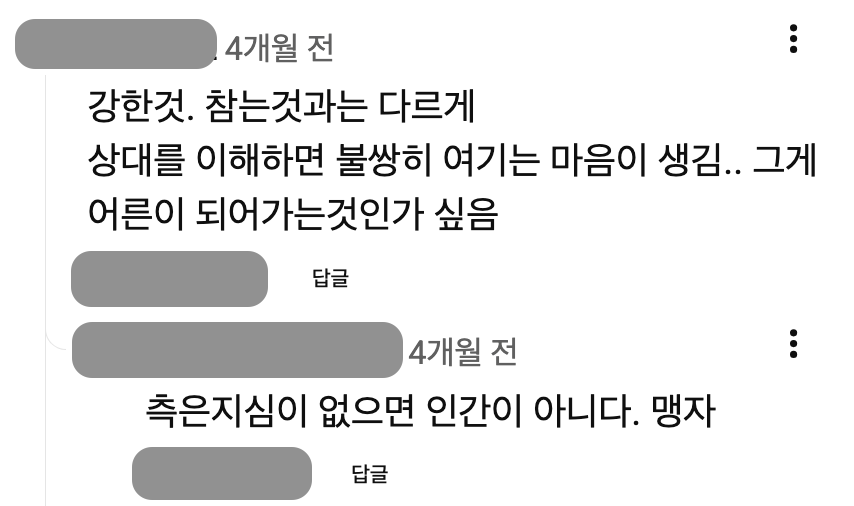

아마도 2-3주 전이었을까. 어째서인지 눈이 일찍 떠져 탄천으로 러닝을 나갔다. 새벽이 지나 태양빛이 푸르게 보이는 시간이었다. 가볍게 2Km 정도를 뛰고 위로 올라가고 있었다.

<!-- truncate -->

작업차량들이 오갈 수 있게 넓은 아스팔트로 된 오르막이었지만, 평소에는 차량 출입을 제한하기 위해 철제 펜스로 막아둔, 그래서 사람 1명 정도가 드나들 수 있는 좁음이었다.

[오르막 사진 첨부]

막 러닝이 끝난 참인 나는 헥헥거리며 오르막을 올라 갔고, 내 뒤로는 여유롭게 산책한 걸로 보이는 중년의 남성이 따라왔다.

그리고 오르막을 다 올라온 내 옆으로는 자전거를 탄 중년의 남성(하지만 밑에서 올라오고 있는 남성보다는 어린 듯한)이 지나갔다.

이 둘이 지나려는 곳은 같았지만, 동시에 지나갈 순 없었다. 심지어 올라오고 있는 남자는 핸드폰을 보고 있었고, 자전거를 탄 남자가 핸드폰 보는 남자의 몫까지 피해야 되는 꽤나 다급한 상황이었나 보다.

그래도 자전거를 날렵하게 움직였는지, 사고는 나지 않았다. 대신 너무 놀라서인지 "에이씨.."라고 중얼거리며 마저 내려가는 남자가 있었다.

핸드폰 남자는 여전히 핸드폰에 집중하면서도 그 말만은 또렷이 들었는지 "아저씨, 지금 뭐라고 했어요!"라며 서로 언성이 높아지기 시작했다.

...

이걸 보고 내가 느낀 감정은 불쌍함과 측은함이었다. 나에게 있어 아침에 나와서 바깥 공기를 누리는 건 감사하면서도 전 날부터의 이른 취침이라는 준비와, 아침에 5분만 더 이불 속에 있고픈 마음. 그런 여러가지 것들이 조합되어야만 가능한 행위다. 그런데 그 조합의 결과물을 일순간을 참지 못해서 망쳐버리다니. 아마 그 둘의 하루는 가족에게 상대를 욕하거나, 혼자서 회상하며 기분 나빠하는 하루가 아니었을까.

---

[리로그 원문](https://www.rilog.kr/@homo_scribens/posts/288)
