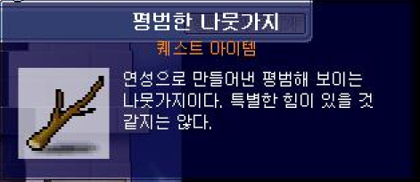
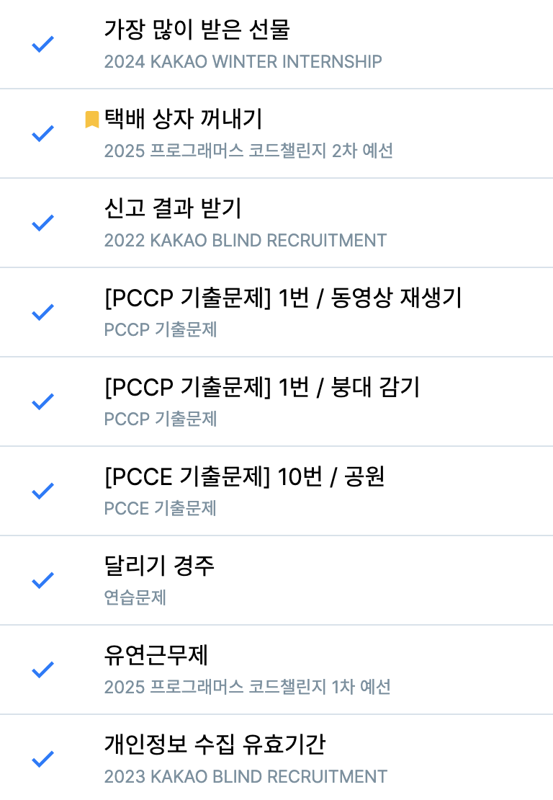
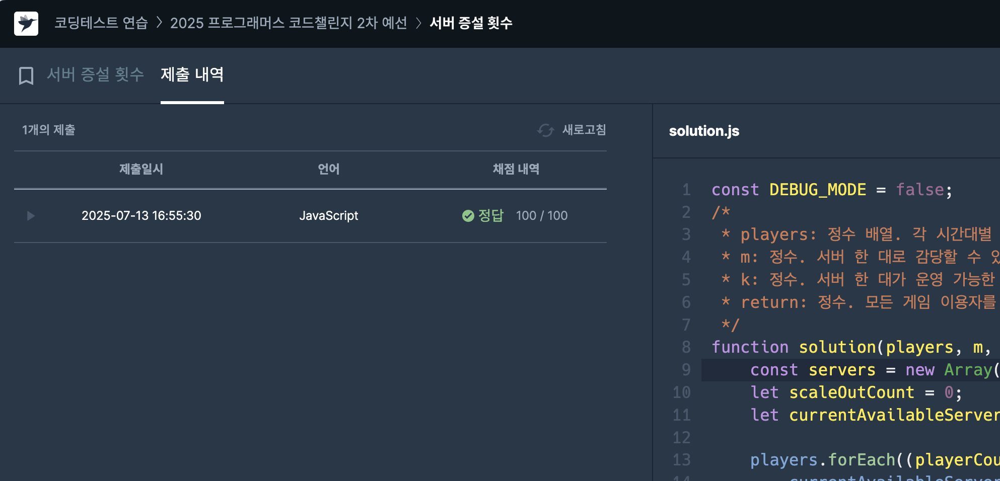

## 잡설

### 꾸준함이 무기다

<figure>



<figcaption>평범한 나뭇가지 | 연성으로 만들어낸 평범해 보이는 나뭇가지이다. 특별한 힘이 있을 것 같지는 않다. (<a href="https://zyquest.tistory.com/270">이미지 출처</a>)</figcaption>
</figure>

ㄴ 그리고 내 무기..

<!-- truncate -->



기록을 보니까 *25년 여름* 정도까지는 문제를 풀던 기록이 있는데, 그 뒤로는 없다. 그래서 다시 re-zero..?

### 루드비코는 프론트엔드가 될 수도 있었다..?



js로도 풀었었네.. 네부캠 준비하던 땐가? 새로운 언어를 사용한다는 것만으로 뭔가 더 설레고 재밌었던 기억이 남아 있다. 사실 그때 당시에는 매일 추가되는 미션이 너무............. 어려워서 맨날 밤새고 오후 4시에 낮잠자고를 반복하는 아주 망가지고 힘들던 삶이었는데, 지나고 보니 또 좋은 기억이 많이 남는다..-

## 이번 도전의 첫 문제는

`달리기 경주 | 연습문제 | Lv. 1`를 풀었다.


### 내 풀이

```java
import java.util.*;

class Solution {
    // 추월할 때 선수의 이름을 부른다
    public String[] solution(
        String[] players, // 1등부터 현재 등수 순서대로 담김. 선수의 이름
        String[] callings // 선수의 이름을 부르는 순서
    ) {
        Map<String, Integer> playerOrderMap = new HashMap<>();
        for (int i = 0; i < players.length; i++) {
            playerOrderMap.put(players[i], i);
        }

        // 1. 이름을 부른다
        for (String calling : callings) {
            int order = playerOrderMap.get(calling); // 2등
            String temp = players[order-1]; // 1등

            players[order-1] = players[order]; // 2등(order) 선수를 1등으로
            players[order] = temp; // 1등(order-1) 선수를 2등으로

            playerOrderMap.put(calling, order - 1); // 추월
            playerOrderMap.put(temp, order); // 추월당함
        }


        // 선수들 이름. 1등, ...,  n등
        return players;
    }
}
```

### 복기

처음에는 `Map`없이 `for (String calling : callings) { brute-force : players }`로 풀었고, 시간 초과가 났다. 여기까지는 ok. 실패를 염두한 빠른 풀이용 접근이었고, "어차피 Map을 사용해야 되긴 하겠는데"라는 직관을 가지고, 간단한 풀이로부터 접근이 맞는지를 판단하기 위해서였다.

#### 문제 발견

그런데 그 뒤에 `temp`를 사용해서 n등 선수와 n-1등 선수를 swap할 때 많이 틀렸다.

```java
playerOrderMap.put(calling, order - 1); // 추월
// 개선 풀이: [order-1]에 있던 플레이어는 temp에 보관
playerOrderMap.put(temp, order); // 추월당함
// 기존에 틀린 풀이: 이미 [order-1]의 플레이어를 바꿨는데, 그걸 바꾸기 전 [order-1] 플레이어로 사용함
// playerOrderMap.put(players[order-1], order);
```

* `playerOrderMap.put(temp, order)` 부분을 `playerOrderMap.put(players[order-1], order)`로 잘못 풀이하니 원래 n-1등 선수가 지워지고, n등 선수가 그 자리를 중복 대체한다.

오랜만에 풀어서 그런가.. 이게 눈에 안 보여서 프린트까지 찍어가며 겨우 찾았다.

```shellscript
kai가 poe를 추월
# bug: poe가 사라지고 kai가 중복 대체
현재 순서: mumu,soe,kai,kai,mine,
kai가 kai를 추월
# bug: kai가 사라지고 mine이 중복 대체
현재 순서: mumu,soe,kai,kai,mine,
mine가 kai를 추월
현재 순서: mumu,soe,kai,mine,mine,
mine가 mine를 추월
현재 순서: mumu,soe,kai,mine,mine,
```

#### 다음에 더 잘 하려면

수상하게 문제를 잘 푸는 오리가 있다. 그 녀석을 엿보았다. 내가 swap에서 헤맬 때 `temp`가 뭐고 `players[order]`가 뭐고, `players[order-1]`가 뭐고, ... 헷갈려서 특히 힘들었는데, 이 오리는 `frontName`이라는 변수명을 사용하더라. `front`라는 표현이 좋다고 느꼈다.

그래도 오리가 풀이를 칭찬해줬는데 익사하려는 뉴비의 목줄을 잡고 모임에서 빠져나가지 못하게 하는 건지... 아직은 잘 모르겠다.

---

[리로그 원문](https://www.rilog.kr/@homo_scribens/posts/313)
