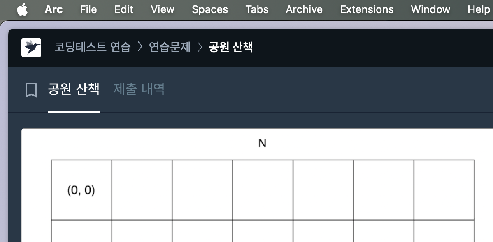

이 글에서 사용되는 예제 코드는 **Java**로 작성되었으며, [공원 산책 | 프로그래머스](https://school.programmers.co.kr/learn/courses/30/lessons/172928) 풀이의 일부입니다.

**이 글을 읽으면:**

```text
풀이가 헷갈려서 중간 출력이 필요한 문제에서 원하는 대로 출력하면서도,
채점 결과에는 중간 출력이 포험되지 않게 할 수 있습니다.
```

<!-- truncate -->

## 결론부터

아래 코드 블록에 있는 `print(String format, Object... args)` 메서드를 정의해서 사용하면 된다.

```java
// 예시 1
print("이동 가능?: now=%s(%d, %d)%n", mat[x][tempY], x, tempY);
print("이동 가능!: now=%s(%d, %d)%n", mat[x][tempY], x, tempY);
print("이동(Y): %d -> %d%n", y, tempY);
// 예시 2
print("=== %d번 째(start_%s) | oper_%s ===%n", count++, start, oper);


public static final boolean DEBUG_MODE = false;

private static void print(String format, Object... args) {
    if (DEBUG_MODE) System.out.printf(format, args);
}
```

## 내가 겪은 어려움

문제를 풀 때 탐색 범위와 기준이 헷갈려서 초반에 헤맸다.. 그래서 중간중간 결과를 출력할 필요를 느꼈고, 처음에는 단순히 `System.out.println()`으로 출력했다.

그랬더니 <u>반복되는 출력 메서드 타이핑</u>과 <u>값 디버깅을 위한 문자열 </u>`+`<u> 연산</u> 등으로 인해 피로해졌고, 두 문제를 해결하기 위해 `print()` 메서드를 정의했다.

```java
private static void print(String format, Object... args) {
    System.out.printf(format, args);
}
```

* <u>반복되는 출력 메서드 타이핑</u>은 메서드로 만든 그 자체로 해결한다.
* <u>값 디버깅을 위한 문자열 + 연산</u>은 `printf()`와 가변인자 `Object... args`로 해결한다.

## 풀이 코드 원문 중 일부

```java
    public static char[][] mat = new char[55][55];
    public static int ROW_SIZE;
    public static int COL_SIZE;

    public int[] solution(
        String[] park, // S, O, X 중 하나
        String[] routes // 강아지가 수행할 명령. "op n" 형태. op=이동 방향, n=칸 수
    ) {
        ROW_SIZE = park.length - 1;
        COL_SIZE = park[0].length() - 1;

        Pos start = new Pos();
        print("<ROW_SIZE=%d, COL_SIZE=%d>%n", ROW_SIZE, COL_SIZE);
        for (int row = 0; row < ROW_SIZE + 1; row++) {
            for (int col = 0; col < COL_SIZE + 1; col++) {
                char target = park[row].charAt(col);
                mat[row][col] = target;
                if (target == 'S') start = new Pos(row, col);
            }
        }

        for (int row = 0; row < ROW_SIZE + 1; row++) {
            for (int col = 0; col < COL_SIZE + 1; col++) {
                print("%s ", mat[row][col]);
            }
            print("%n");
        }

        int count = 1;
        for (String oper : routes) {
            print("=== %d번 째(start_%s) | oper_%s ===%n", count++, start, oper);
            if (start.canMoveTo(oper)) {
                start.move(oper);
            }
        }

        int[] answer = {start.x, start.y}; // 모든 명령을 수행 후 강아지가 놓인 위치: [세로, 가로]
        return answer;
    }
```

---

[리로그 원문](https://www.rilog.kr/@homo_scribens/posts/328)
