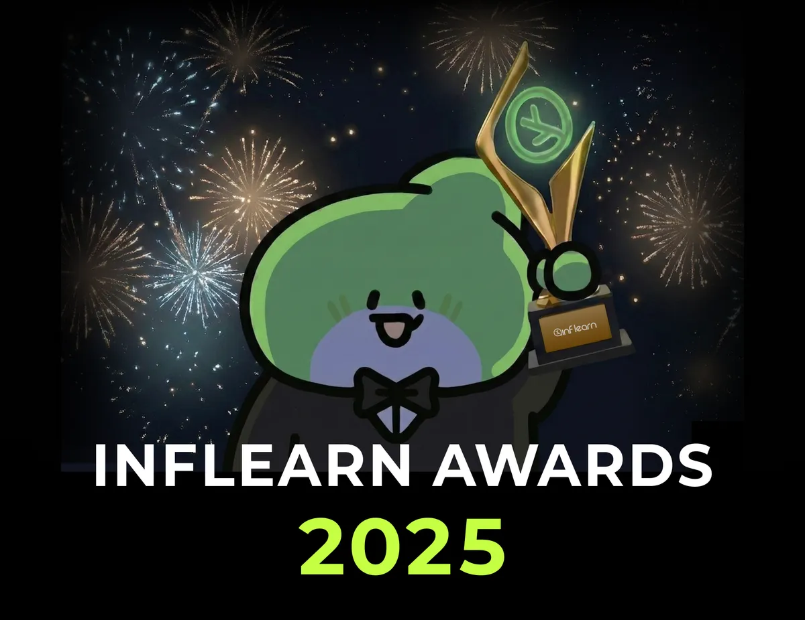
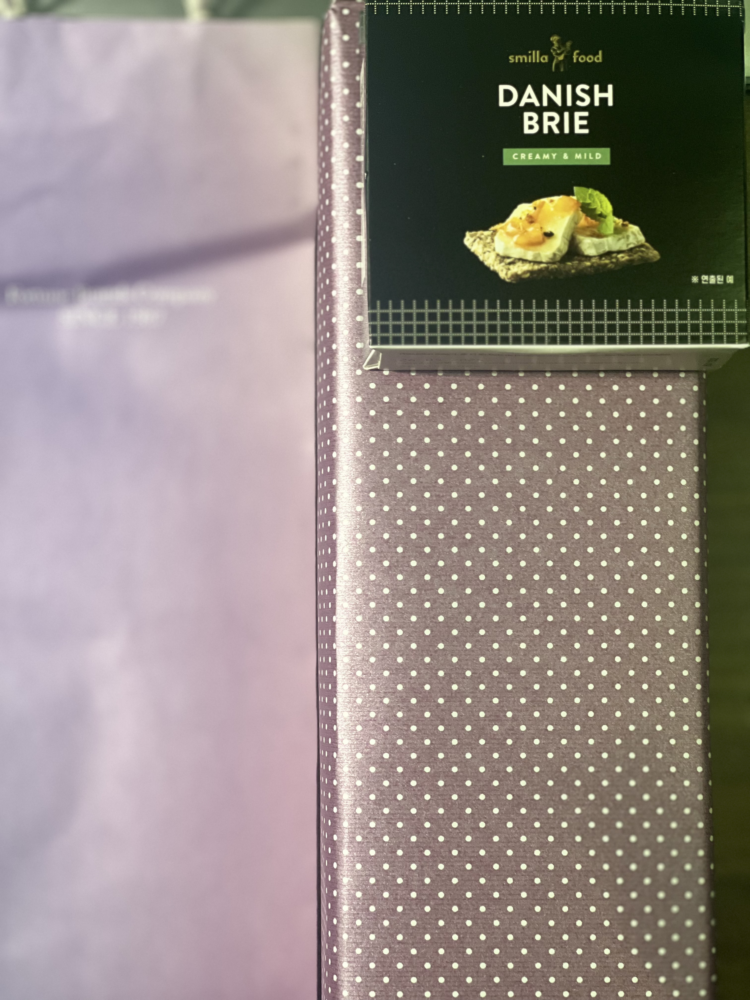
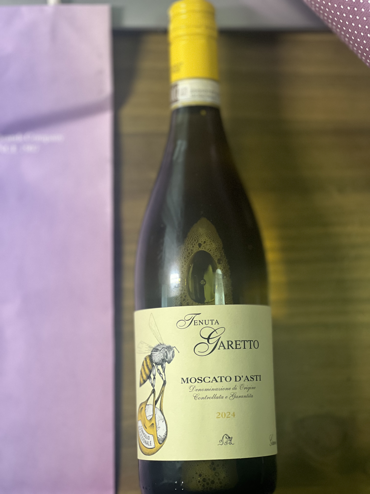
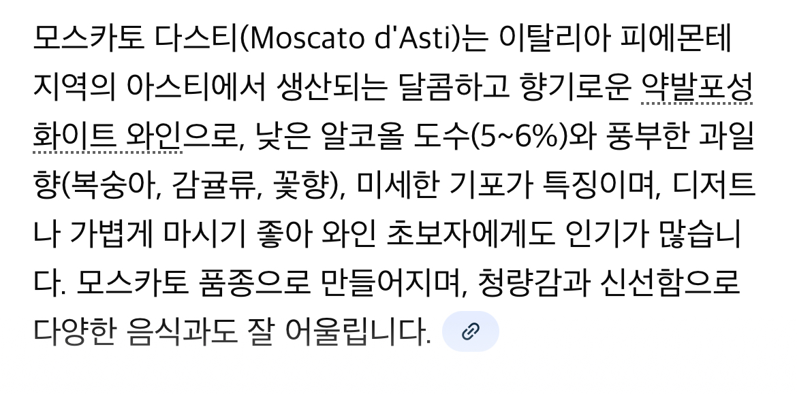

Inflearn picked me for its end-of-year award for answering questions!

Yes, that’s me. I’d like to share this award with the production team, who worked so hard, and with… well, you know the speech.

<!-- truncate -->

---

## How the gift found its way to me

I didn’t even know Inflearn had end-of-year awards. When an email came asking for my address, I took it for one of their regular promotional emails and went right past it.

Luckily for me, someone at Inflearn thought to follow up by text. I got my address in after all.

And what arrived? Wine and cheese! Just the thing for us grown-up kids studying hard on Inflearn.

## Why did I start answering questions?
I learn a surprising amount from answering other people’s questions. And I enjoy the answering itself.

There’s quite a distance between knowing something and helping someone else understand it. Sometimes I wonder how well I know a thing if I can only explain it to myself.

I’ve often started typing with a cheerful “Oh, I know this one! Let me explain,”
only to stop halfway through. “I’ve always taken this bit for granted. How would I explain it to this person?” Or, “Is that actually true? Where does the official documentation say so?”

That’s the weight of telling someone how something works.

To finish the answer, I have to put what I know into words someone else can follow and find evidence for it. In the process I fill in gaps I hadn’t realized were there.

## A soft spot for Inflearn

I already liked Inflearn and was happy using it. I can hardly pretend an end-of-year present hasn’t made me a little fonder of it.

Inflearn gave me a chance to leave them a message, so I tried to fit all that affection into it. I’ll leave it here to close out the post.

---

#### A note to Inflearn
> I had no idea you did anything like this. What a lovely way to end the year!
>
> For the past couple of months I’ve been at the Baemin bootcamp, working on the fundamentals as I prepare to look for a job. I haven’t been on Inflearn as much, so it was lovely to be included on the strength of the answers I’d been posting before that.
>
> I kept volunteering answers for two reasons. Writing them helped me, and I thought someone might get as much out of mine as I’d gotten out of other people’s.
>
> Other students’ answers have often left me with a new question. Chasing it down helped me grow, and sometimes one answer gave me a way of seeing something that hadn’t occurred to me at all.
>
> I started answering to return a little of that kindness. Of course, having to explain something to someone else helped me work on my own weak spots, too.
>
> Inflearn was there when I first started learning to program. I’m pretty attached to it.
>
> Over the last few years I’ve watched the mobile app get updates, new features arrive, and events come and go. I catch myself thinking, “They’re really working at this. Look how much room they still have to grow.” It makes me oddly proud.
>
> I’ve found every course I needed on Inflearn. I haven’t even signed up for another service, though I think there are two or three others in Korea.
>
> I’m not sure what you currently offer new members. A generous welcome offer might be worth a try. Once people start taking courses, I can see them sticking around.
>
> Another way to reach new students might be to get in touch with university administrators or student councils and set up a little campus booth with courses or coupons to give away.
>
> They’re in different businesses, but Notion recruits student ambassadors, and I’ve often seen Monster giving away energy drinks on campus.
>
> Another thought as I write this: if a few instructors were interested, perhaps Inflearn could approach a university about hosting a guest lecture. I can imagine that going over quite well.
>
> This has turned into a long note. I hope you have a lovely end to the year, and that in 2026 both Inflearn and I get a little closer to the things we’re working toward!
