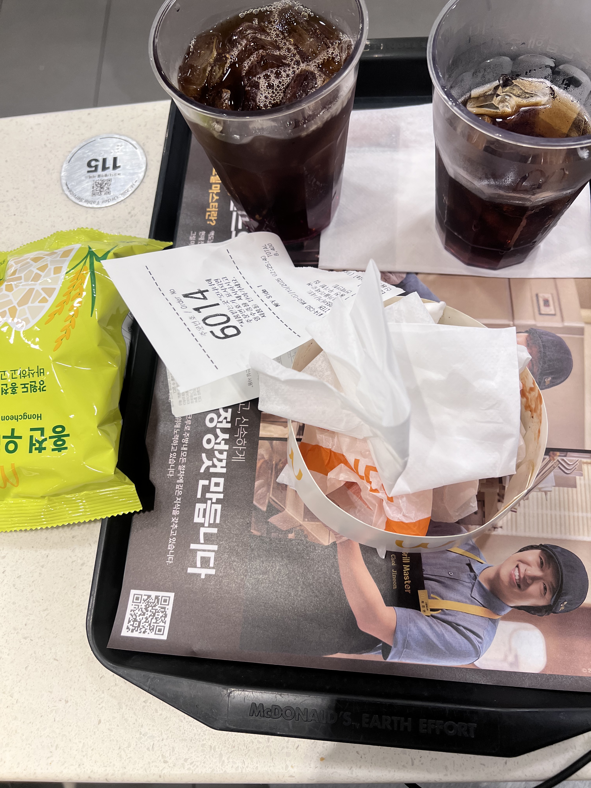
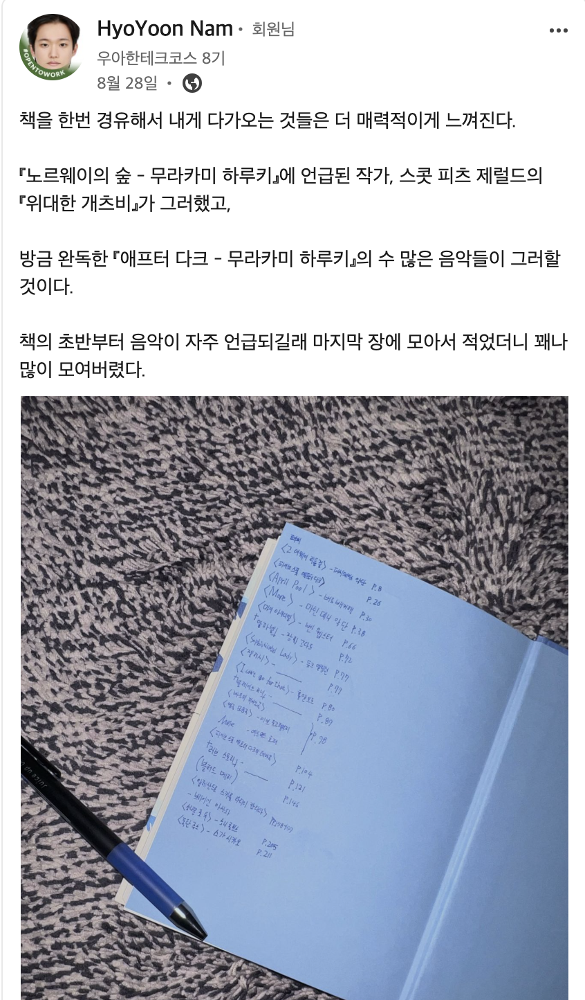
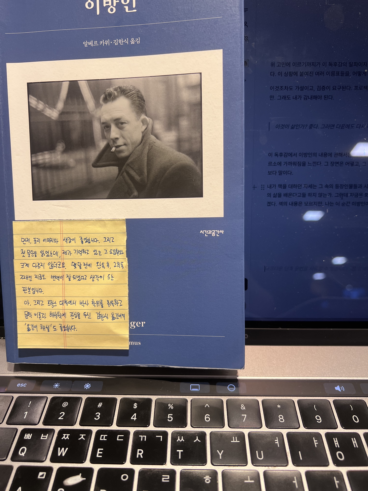

Actually, the hamburger can’t keep me company. I’ve already devoured it without mercy. Then again, maybe it’s closer to me now than it was before I ate it. *What does it matter, anyway?*

<!-- truncate -->

It’s 2:50 in the morning. Wednesday, October 7. I’m at the McDonald’s by Sunae Station. There’s something reassuring about a chain that stays open all night. Even when I’m away from home, there’s somewhere I can stay, whatever the hour.

Why am I awake at this hour? And why am I here when I have a perfectly cozy home? Well, here you’ve found me, writing about *The Stranger*. I figured if I was going to work through the small hours anyway, I might as well get something to eat and give myself a change of scenery.

I hadn’t actually set out to write about *The Stranger*. I did have to write it eventually. A few of us at Woowacourse had read the book and got together to talk about it, and we’d agreed to bring something we’d written to follow up. But just before I started this, I was making a list of things I’d done, for my application to an entry-level opening at MyRealTrip.

Then a couple of thoughts occurred to me.

* Looking back over my time at Woowacourse for the application, I could see a resemblance between MyRealTrip and our project. In both, the starting point was the problem we wanted to solve.
* If I got the job, what could I do at MyRealTrip with the things I already love?
  * I like books. I have a soft spot for films, music, other books, food, even places, once I’ve come across them in a book. Japanese fiction does this to me in particular. People travel around taking photos of places they’ve seen in anime. What if you could plan a route that let you visit places you’d read about, or try the food? I remember reading Haruki Murakami’s *After Dark* and jotting down the things that turned up in it in the back of my copy. A lot of it was music. It was fun. It made me want to build a little wiki of my own as I went through life.

* I like running. Travel abroad has never stirred much in me either way. Lately, though, just picturing myself out for a run overseas makes my heart swell. And a good running route is hard to plan. Especially a long one. There are only so many laps of a track you can do before it gets old. It’s tricky enough at home, so I imagine it would be harder in another country. What if we could map out routes in enough detail for people to go running with peace of mind?

As you can probably tell from all that rambling, I got quite excited at the thought of where MyRealTrip was headed and how much fun I might have there. Forming hypotheses, making decisions with data, seeing something through from start to finish even when it took me outside my area. I’d made a point of practicing all that at Woowacourse. I could almost believe those experiences had come my way specifically for MyRealTrip.

And then there’s this. Would another company recognize what I’m writing down here? Would they see any value in it? The other backend developers in my cohort seem to be preparing for their applications in a rather different way.

> *Am I a stranger on the job market?*

Getting as far as that question is the beginning and the end of this book report. It’s a question that worries me. It makes me anxious. It’s a challenge, too. I’ve got all these names for the situation, and I don’t know quite what to do with any of them.

Even this is a hypothesis. It needs testing. The weight of it is rather different from that of a hypothesis in a project or a survey. A good deal heavier. Still, it’s mine to bear.

> *Is this life? Good. Then I’ll do it again.*

I’ve written a book report without saying what happens in *The Stranger*. Yet I feel closer to Meursault now than I did when I still had the whole book fresh in my head, scribbling in the margins about what a scene was doing or what a sentence stood for.

The way I used to read was to get a feel for the people in a book, for the time they lived in, and to enjoy being there. People say books let you learn about other people’s lives. And yet, as far as Meursault’s own life goes, I feel further away from it now. I don’t know what the book is about. I don’t know what it’s about, but right now, I’m a stranger.

### *3:33 a.m. This is where I stop.*

---

[Original post on Rilog (Korean)](https://www.rilog.kr/@rudevico/posts/155)
