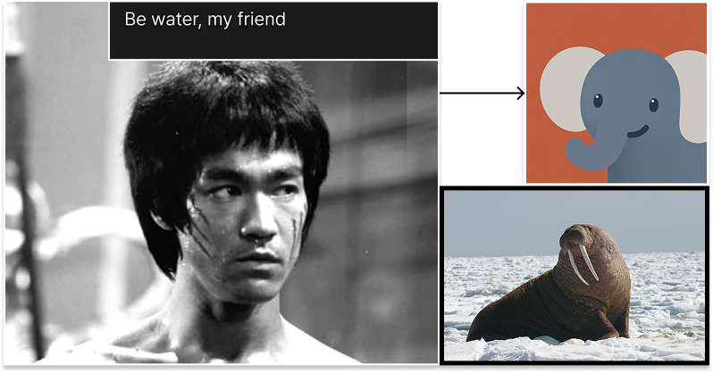
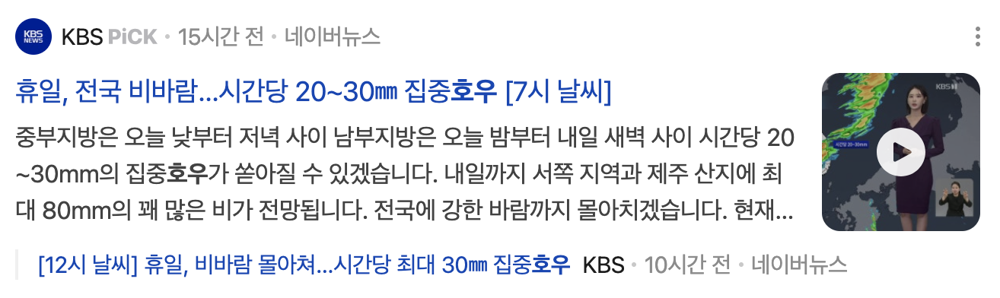
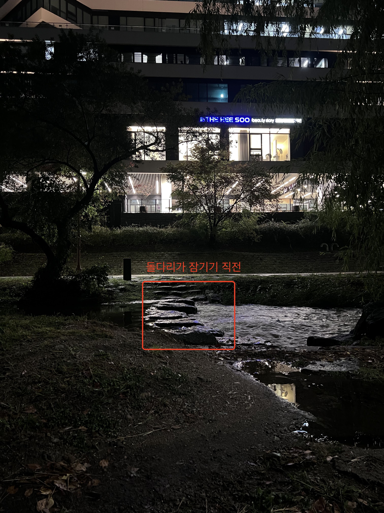
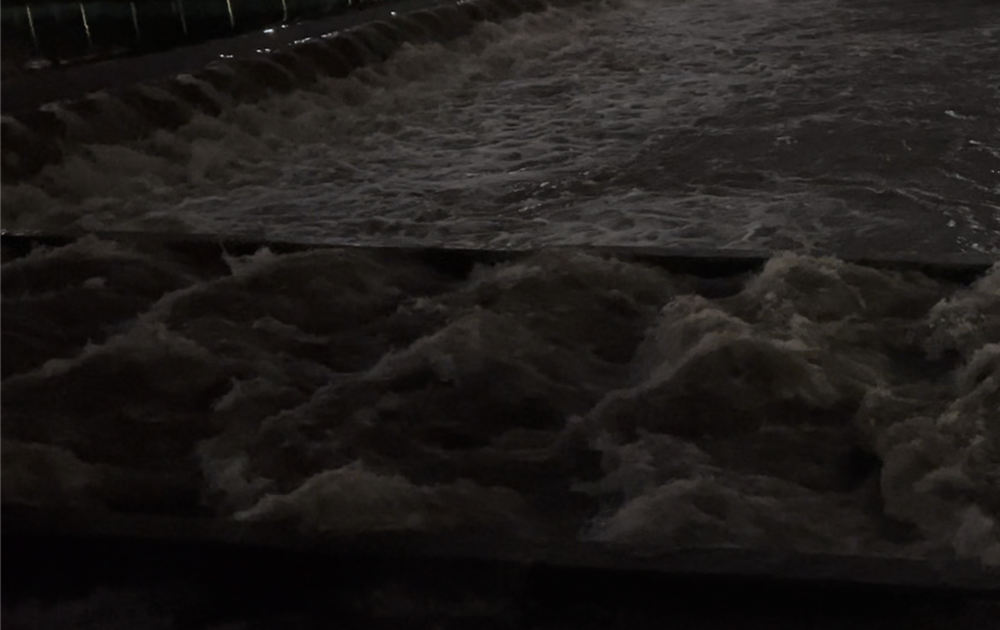
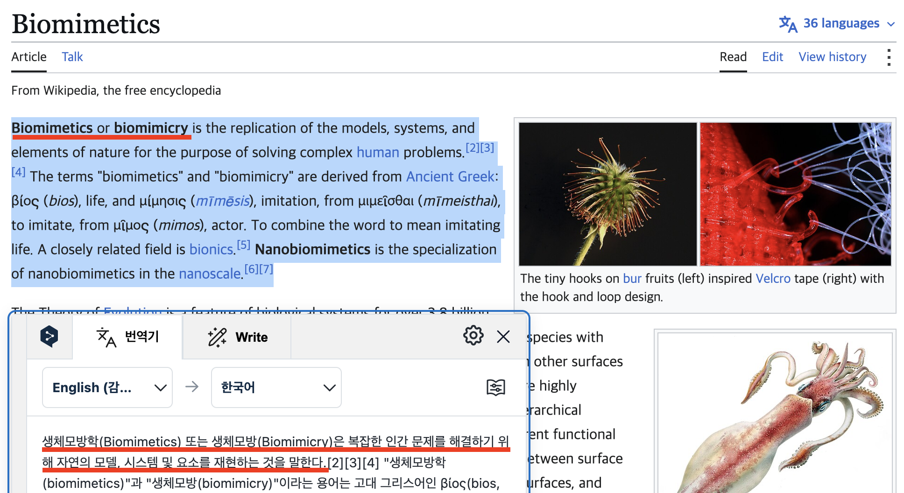
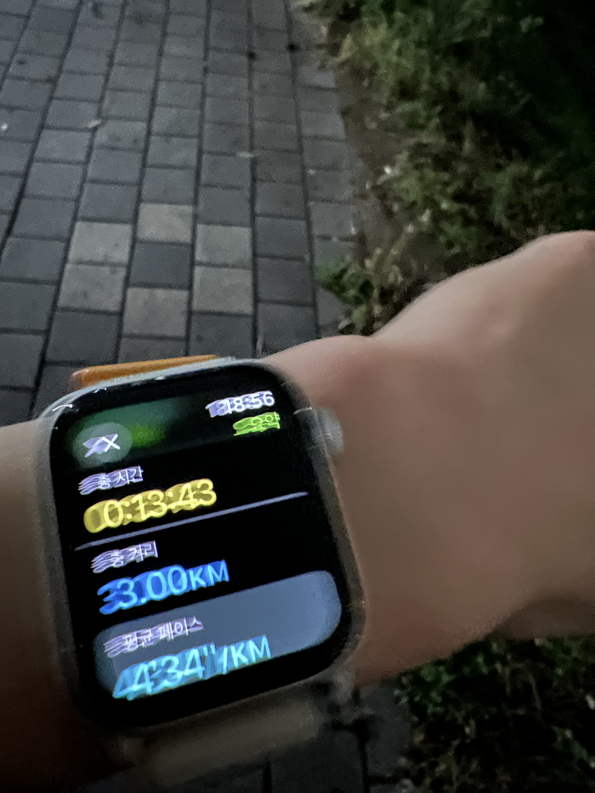
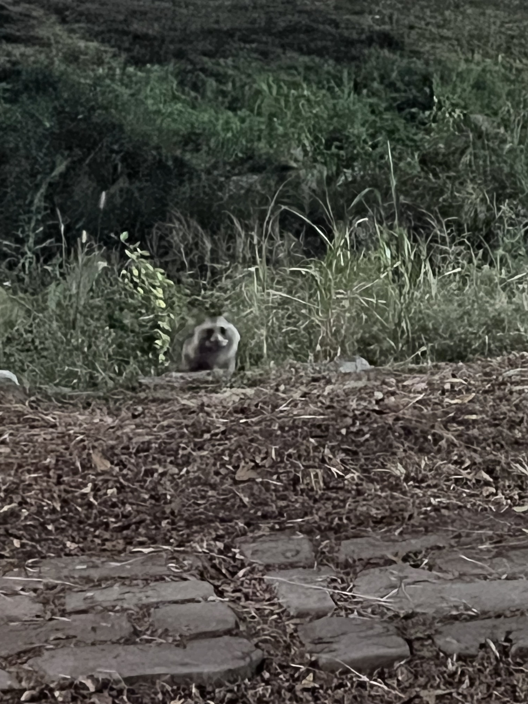
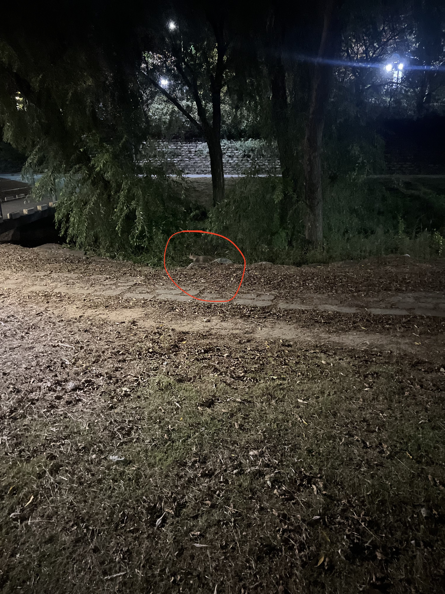
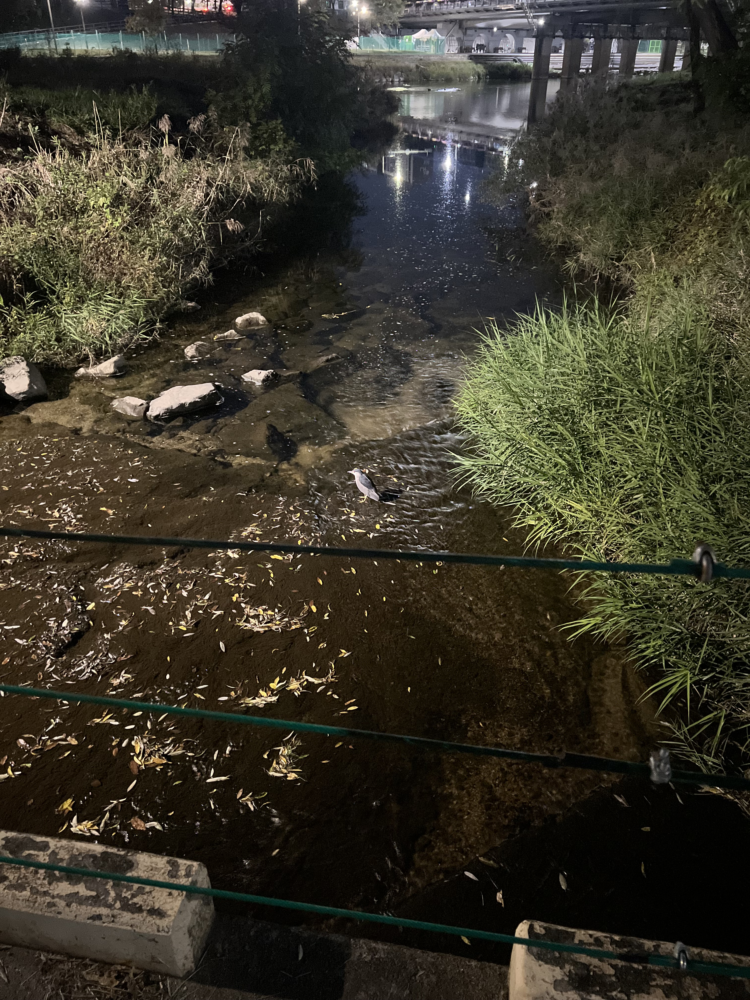
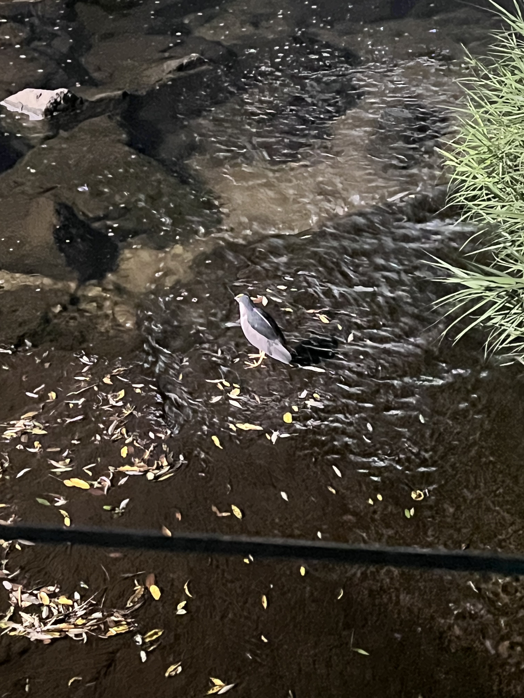

## Becoming water

<figure>

<figcaption>1. YTN reports a heavy rain advisory for Seoul and Gyeonggi.</figcaption>
</figure>

<figure>

<figcaption>2. The same advisory on KBS.</figcaption>
</figure>

*It’s a Sunday in the autumn of 2026, and the rain is coming down hard.* By about six in the evening, though, it was letting up. I started getting my running things together.

<!-- truncate -->

Down at the Tancheon, you could see what the rain had done. The water was just shy of covering the stepping stones between the two banks.

<figure>

<figcaption>3. The stepping stones, just above water.</figcaption>
</figure>

As if the stream had decided it couldn’t hold much more, the current was picking up, carrying the water off to some place far away.

<figure>

<figcaption>4. All that water rushing downstream.</figcaption>
</figure>

I was admiring the way water could flow quietly or pick up speed as the occasion called for it, when something I’d heard once came back to me. A lot of our technology comes from watching what nature does.

> It matters to me to have some breathing room in my life. But when things need doing, maybe I can let the current run a little faster for a while. Like water.

So I’ve decided to be water. With so little of my time at Woowacourse left, I think I’m going to need a fairly brisk current.

<figure>

<figcaption>5. Biomimetics, on Wikipedia.</figcaption>
</figure>

<figure>

<figcaption>6. Today’s run.</figcaption>
</figure>

### Friends along the Tancheon

Last time I ran here I saw raccoon dogs and a bird. I wonder how they fared today.

<figure>

<figcaption>7. Raccoon dog A.</figcaption>
</figure>

<figure>

<figcaption>8. Raccoon dog B.</figcaption>
</figure>

<figure>

<figcaption>9. A bird. Asleep, perhaps?</figcaption>
</figure>

<figure>

<figcaption>10. A closer look.</figcaption>
</figure>

## Reading Bacon’s “Of Adversity” in the Moonye edition

This essay suggests a way to take pleasure in adversity. Several passages circle the same idea, so I’ll finish by gathering them here, in my own English from the Korean edition.

> The good things of prosperity are worth wishing for. The good things of adversity are worth admiring. — Seneca

I’ve been seeing <strong>[a Korean collection of Seneca for people who feel today slipping away](https://www.yes24.com/product/goods/192474512)</strong> everywhere lately. It was a surprise to run into him in Francis Bacon, too.

> Surely, if miracles have power over nature, it’s in adversity that they tend to appear.

> The virtue of prosperity is temperance, and the virtue of adversity is fortitude. Of the two, fortitude is by far the more heroic.

> Prosperity is the blessing of the Old Testament. Adversity is the blessing of the New. It promises greater grace and reveals God’s protection more clearly.

> Even in adversity there is comfort and hope. In needlework or embroidery, how much more pleasing to set a lively pattern against a grave, somber ground than to lay a dark, melancholy pattern on a bright one.

> Prosperity brings our vices into view. Adversity brings out our virtues.

### Words I had to look up

* **Holy Spirit**, also *Holy Ghost*. It’s a Christian term. Even with an explanation in front of me, I find it hard to grasp. I’ve seen Christians in Korea and elsewhere writing about their own confusion over it, too.

> The pen of the Holy Spirit also dwells more on the afflictions of Job than on the splendor of Solomon.

* **Needlework.** Making something by hand, sometimes with the help of a simple tool.

> In needlework or embroidery, to set a lively pattern against a grave, somber ground…

---

[Original post on Rilog (Korean)](https://www.rilog.kr/@homo_scribens/posts/198)
