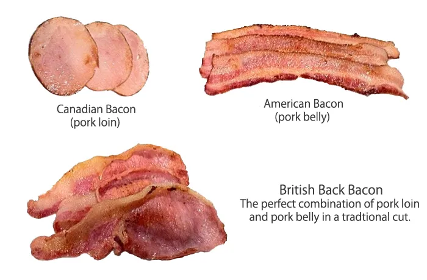
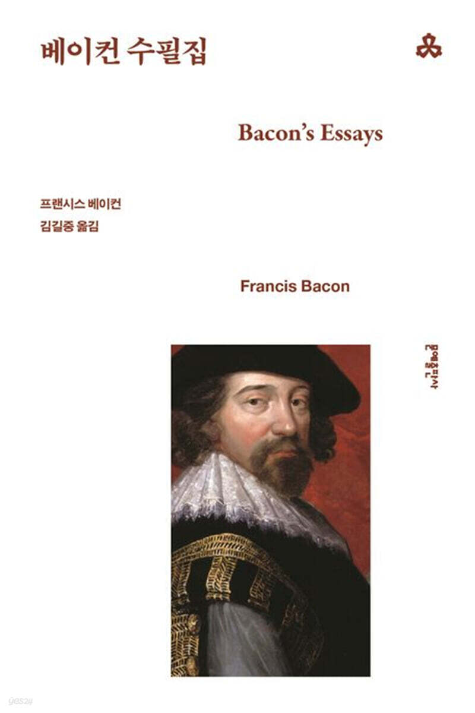

Was it five days ago? I bought the Moonye edition of Francis Bacon’s essays. I knew his line about knowledge being power, and that was about all I knew of him. I happened upon the book and wanted to get better acquainted. My other reason was the size of the essays. There are nearly sixty subjects in some 270 pages. One a day sounded like a pleasant little habit.

<!-- truncate -->

<figure>

<figcaption>https://www.yes24.com/product/goods/147564050</figcaption>
</figure>

## No cause to be angry with someone?

> *Who does another person harm just for the pleasure of doing harm? People do it for some gain or pleasure or honor of their own. Why, then, should I be angry with someone for loving himself more than he loves me?* — Francis Bacon, “Of Revenge,” translated here from the Korean edition

It reminded me of the saying that if you expect nothing, you won’t get angry. But suppose someone has a bad habit, and I keep quiet because, well, it’s their loss. Isn’t that also a failure to communicate? If we care about each other’s growth, wouldn’t it be better to say something?

Bacon stops at “there’s no need to get angry.” He doesn’t offer an alternative like “keep calm and talk it through.” I’m left wondering how much he includes under anger. Does it cover telling someone off in a temper and giving them ordinary feedback? If I read it that broadly, I’m back where I started. Staying quiet could end up hurting us both.

## Words I had to look up

* **Gomaehada** (고매하다). To be distinguished or noble in character, learning, or talent.

> By comparison, the spirit of Job speaks in a nobler voice.

* **Proverbs.** The biblical book numbered 24th or 20th, depending on the ordering. Solomon is traditionally credited with writing or compiling many of its sayings. These are the names in different languages. I take the word to mean something like a maxim or a piece of counsel.

<table>
  <tbody>
    <tr><th scope="row">Hebrew</th><td>משלי (Mishlei)</td></tr>
    <tr><th scope="row">Greek</th><td>Παροιμίαι (Paroimiai)</td></tr>
    <tr><th scope="row">Latin</th><td>Proverbia</td></tr>
    <tr><th scope="row">English</th><td>Proverbs</td></tr>
    <tr><th scope="row">Korean</th><td>잠언 (箴言), literally “words that prick like a needle”</td></tr>
  </tbody>
</table>

## A little feedback for Rilog

### 1. I can’t nest a table under a bullet

* A bullet
  * A nested bullet
* A bullet

> I can put a quotation under a bullet.

* A bullet

<table>
  <tbody>
    <tr><td>The table won’t go under the bullet.</td><td></td></tr>
    <tr><td></td><td></td></tr>
  </tbody>
</table>

### 2. Searching the commands for “table” turns up nothing

When I type `/table`, I expect a table to come up. It doesn’t.

---

[Original post on Rilog (Korean)](https://www.rilog.kr/@homo_scribens/posts/195)
