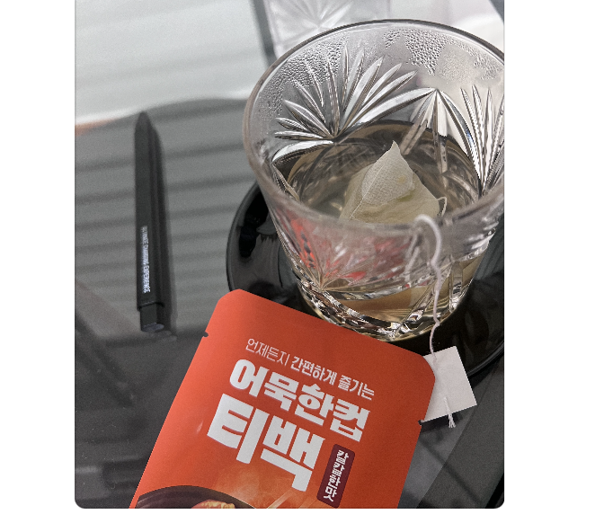

I’m ending the day with a teabag of fish-cake broth. Anyone at Woowacourse could tell you that Elephant, yours truly, doesn’t like fish cake. Especially fish-cake soup.

And yet today is the sort of day I want to end with that teabag. Does Elephant actually like fish cake?

<!-- truncate -->

***

> To be remembered, to accomplish something, to do noble deeds: these belong to human beings. The noblest works and foundations have come from people without children. Having no image of their bodies to leave behind, they strive to give expression to an image of their minds. — From the Korean edition

I liked the way Bacon starts with the animal instinct to continue a line. If you don’t satisfy it by leaving descendants, an image of your body, he suggests you’ll try to leave an image of your mind.

Having a child is a great thing in itself. It can change what you live for and what you hope to do. And surely it changes how you divide up your hours? People often marry around the time they’re coming into their own physically and at work. If they put marriage aside and poured those hours into their work or research, I can imagine more of what Bacon calls an image of the mind surviving them.

Then again, the longer you wait for the right time to marry, the more tempted you are to hold out for the *best* time. Maybe there’s something to marrying when you still don’t feel ready.

> Parents would do well to choose their children’s occupations and paths early, when the children are still adaptable. It is possible to defer too much to their preferences in the belief that they should do whatever they please. Where a child shows a remarkable inclination or talent, of course, it is best to let it have its way.

Does he mean that if parents choose early, the child gets to try something sooner and has less to lose by trying something else if it doesn’t fit? I’m going by that bit about being adaptable. I’m finding this one difficult.

---

[Original post on Rilog (Korean)](https://www.rilog.kr/@homo_scribens/posts/217)
