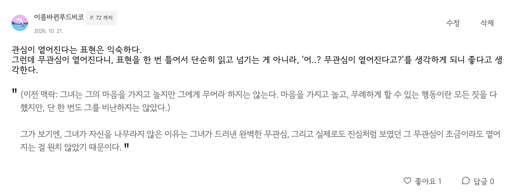
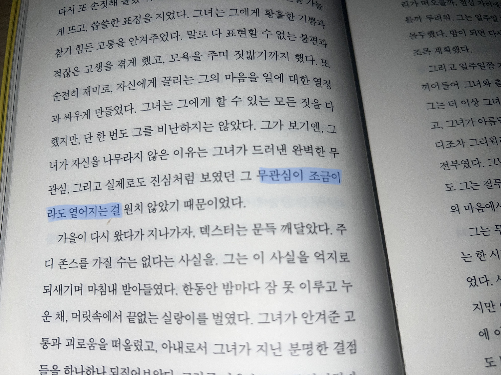

> *As he saw it, she hadn’t reproached him because she didn’t want anything to dilute the complete indifference she’d shown him, an indifference that had seemed quite genuine.* — F. Scott Fitzgerald, “Winter Dreams,” translated here from the Korean edition

<!-- truncate -->

I don’t linger over books. I tend to skim along by feel, with no particular ambition to understand a book in its entirety. Every so often, though, I catch myself slowing down.

〰️〰️

It happened when I came across the idea that **indifference could fade**. It stayed with me enough that [I even wrote down a thought about it](https://chaekchaek.com/download).

<figure>

<figcaption>The note I left on Chaekchaek about fading indifference.</figcaption>
</figure>

Think of something you’re indifferent to. Perhaps you’ve never even noticed your indifference. A tissue fluttering in the air conditioning at a restaurant, say, or a gray ball of dust on the floor beside your desk.

Then there’s a moment when that indifference wears thin. The fluttering tissue suddenly starts to bother you. Someone walks past and the little ball of dust goes skittering off, and your eyes follow it…

〰️〰️

I wonder if it’s the same with people. Maybe what I feel first is my indifference fading.

 〰️〰️

<figure>

<figcaption>Fading indifference. The end.</figcaption>
</figure>

---

[Original post on Rilog (Korean)](https://www.rilog.kr/@homo_scribens/posts/231)
