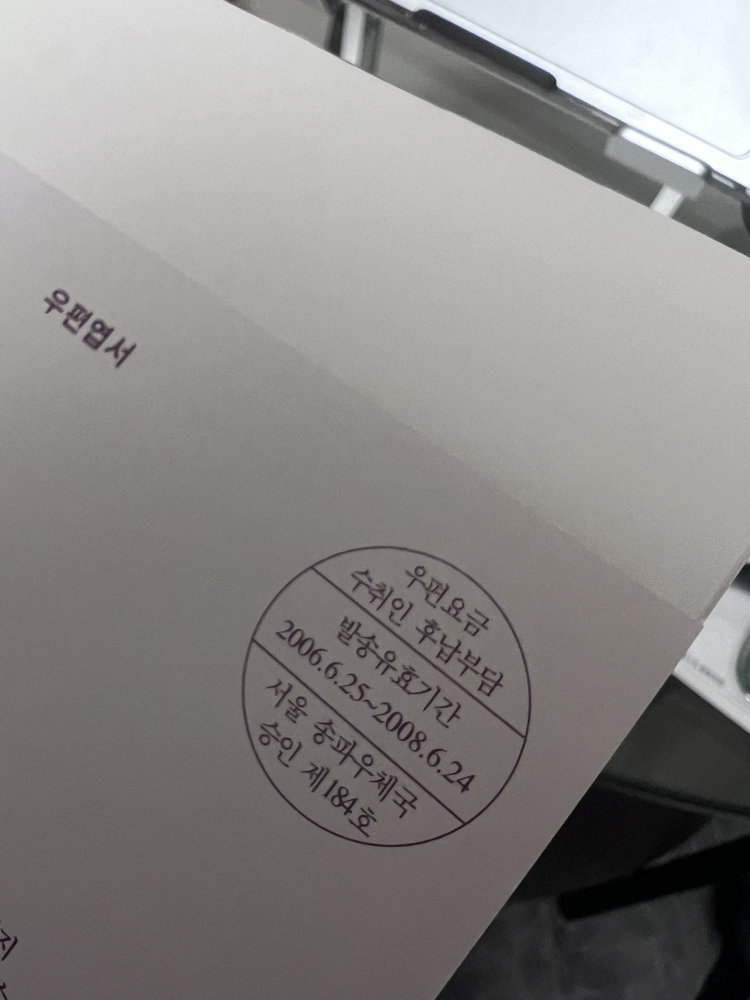
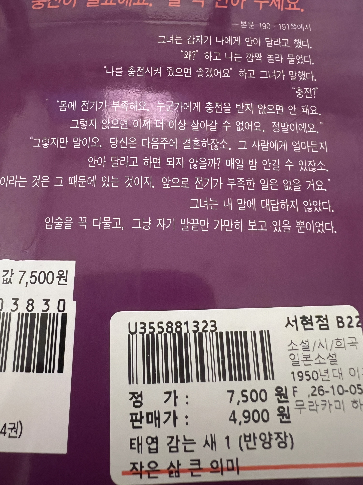
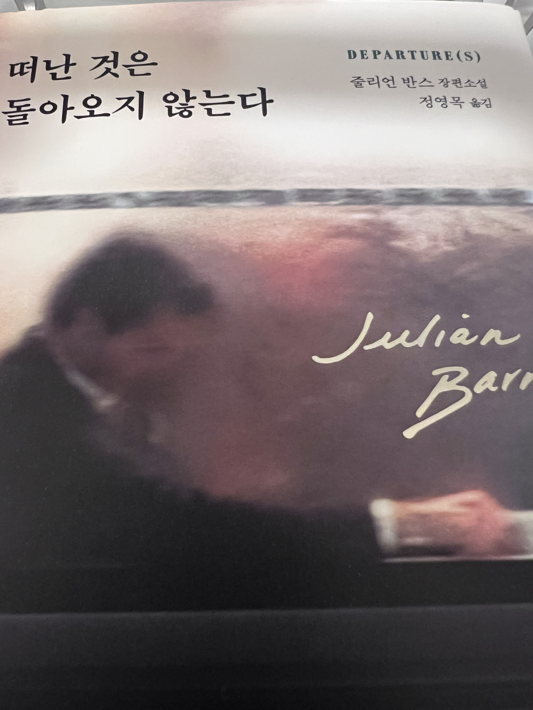

## I bought a book.

Volume one of Haruki Murakami’s *The Wind-Up Bird Chronicle*.

<!-- truncate -->

<figure>

<figcaption>Volume one of The Wind-Up Bird Chronicle, from an Aladin secondhand bookshop.</figcaption>
</figure>

I got it secondhand for 4,900 won. Isn’t that ridiculously cheap? I was happy. What made me happier still was that it was a **well-aged book**.

<figure>

<figcaption>Tucked inside was a postcard that expired in 2008.</figcaption>
</figure>

Oh, and I bought a fabric book cover. Was it 10,800 won?

## Except…

Here’s where things went awry. Two beeps from the scanner, and the cashier said:

> “If you spend 20,000 won, you get 3,000 won off. Shall I ring these up as they are?”

This happened last time, too. Buying more to get the discount would cost me more than skipping it, I thought.

> “Just these, please.”

And then I went home.

## So why…?

Why was it that today I heard myself say,

> “Oh, then I’ll have another look around.”

Where did that come from?

Off I went to find a book that would bring me up to the threshold. If I was buying one, I wanted one I actually cared about. English and American fiction, Japanese fiction, popular science, the Minumsa World Literature shelves… I drifted from section to section.

Nothing. Nothing I felt drawn to.

It’s hot in Aladin. I was wearing long sleeves, a lightweight puffer, and a trench coat. The trench coat had long since ended up over my arm. I thought my arm might give out if I added the puffer, so I wandered around with it half off, flapping behind me.

Half off, half overheated. My arm was heavy, and the rest of me was starting to feel it. Still no book. I’d already sunk ten minutes into this. I finally took the puffer all the way off and browsed in slightly more comfort, but my body had already got the message.

And so, suddenly worn out, I picked up Julian Barnes’s *Departure(s)* and trudged home.

<figure>

<figcaption>The book I finally settled on, Departure(s) by Julian Barnes.</figcaption>
</figure>

When I pick a book, something about the title and the author’s name has to catch me on sight. It has to look cool to me. This title is so much my sort of thing that I’d had my eye on it for ages. How did it take me that long to spot it?

When I started writing this I was still thinking, **what a waste of a trip to the bookshop**. Now I’m looking at my two books and I feel rather pleased. Maybe it does come down to where you choose to end the story.

---

[Original post on Rilog (Korean)](https://www.rilog.kr/@homo_scribens/posts/264)
