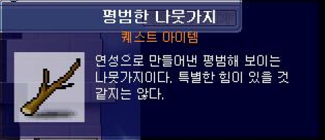
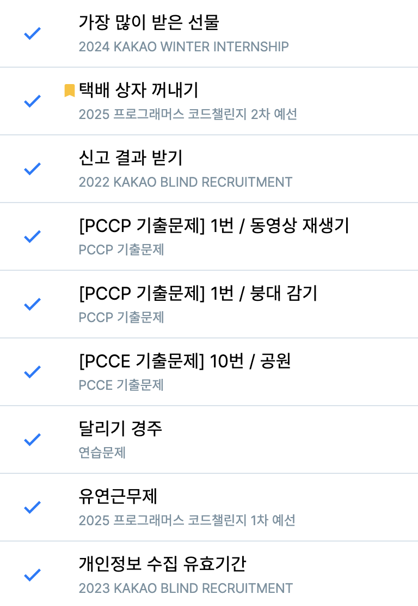
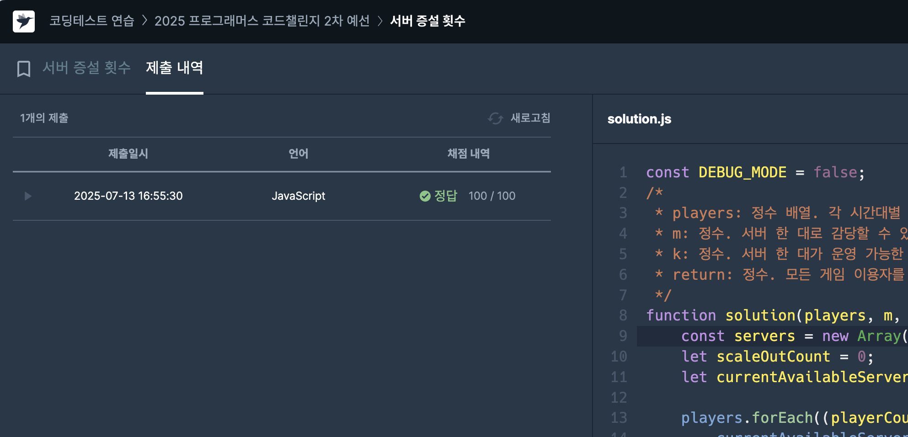

## A little digression

### Consistency is a weapon

<figure>



<figcaption>Ordinary Twig. A perfectly ordinary-looking twig made through alchemy. It doesn’t seem to have any special powers. (<a href="https://zyquest.tistory.com/270">Image source</a>)</figcaption>
</figure>

↳ And there’s my weapon.

<!-- truncate -->



My history shows I was solving problems until about the *summer of 2025*. After that, nothing. Back to square zero, then?

### Could Rudevico have been a frontend developer?



Apparently I solved some in JS, too. Was that when I was preparing for Naver Boostcamp? I remember how exciting it felt just to be using a new language. At the time, the missions that landed every day were so… incredibly… hard. I was forever staying up all night and crashing at four in the afternoon. I was a wreck. Funny how many good memories I have of it now.

## The first problem on my return

I went with `Running Race | Practice | Level 1`.


### My solution

```java
import java.util.*;

class Solution {
    // A runner’s name is called when they overtake someone.
    public String[] solution(
        String[] players, // Runners in their current order, starting with first place
        String[] callings // Names in the order they are called
    ) {
        Map<String, Integer> playerOrderMap = new HashMap<>();
        for (int i = 0; i < players.length; i++) {
            playerOrderMap.put(players[i], i);
        }

        // 1. Call a name.
        for (String calling : callings) {
            int order = playerOrderMap.get(calling); // Runner in second, for example
            String temp = players[order-1]; // Runner in first

            players[order-1] = players[order]; // Move the second runner into first.
            players[order] = temp; // Move the former leader into second.

            playerOrderMap.put(calling, order - 1); // Overtook
            playerOrderMap.put(temp, order); // Was overtaken
        }


        // Names in finishing order, from first through nth
        return players;
    }
}
```

### Looking back

At first I skipped the `Map` and tried `for (String calling : callings) { brute-force : players }`. It timed out. So far, fine. I suspected I’d need a map anyway. A quick solution I expected to fail would tell me whether I was approaching the problem the right way.

#### Where I went wrong

Then I kept getting the swap wrong. All I wanted to do was use `temp` to exchange the runners in positions n and n−1.

```java
playerOrderMap.put(calling, order - 1); // Overtook
// Fix: temp still holds the runner who occupied [order-1].
playerOrderMap.put(temp, order); // Was overtaken
// Bug: [order-1] has already changed, but I treated it as if it still held the previous runner.
// playerOrderMap.put(players[order-1], order);
```

* I’d written `playerOrderMap.put(players[order-1], order)` where I needed `playerOrderMap.put(temp, order)`. The original runner in position n−1 dropped out of the ordering, and the runner from position n appeared twice.

Maybe I was rusty. I had to print the whole thing out before I could see it.

```shellscript
kai overtakes poe
# bug: poe disappears and kai appears twice
Current order: mumu,soe,kai,kai,mine,
kai overtakes kai
# bug: kai disappears and mine appears twice
Current order: mumu,soe,kai,kai,mine,
mine overtakes kai
Current order: mumu,soe,kai,mine,mine,
mine overtakes mine
Current order: mumu,soe,kai,mine,mine,
```

#### Something for next time

There’s a Duck in our group who’s suspiciously good at these problems. I had a peek at their solution. While I was losing track of what `temp`, `players[order]`, and `players[order-1]` stood for, Duck had a variable called `frontName`. I liked that word, *front*. It told me who was standing where.

Duck did say nice things about my solution. Whether that was praise or a way to fish a drowning newbie out by the collar and keep them from escaping the group… I’m still not sure.

---

[Original post on Rilog (Korean)](https://www.rilog.kr/@homo_scribens/posts/313)
