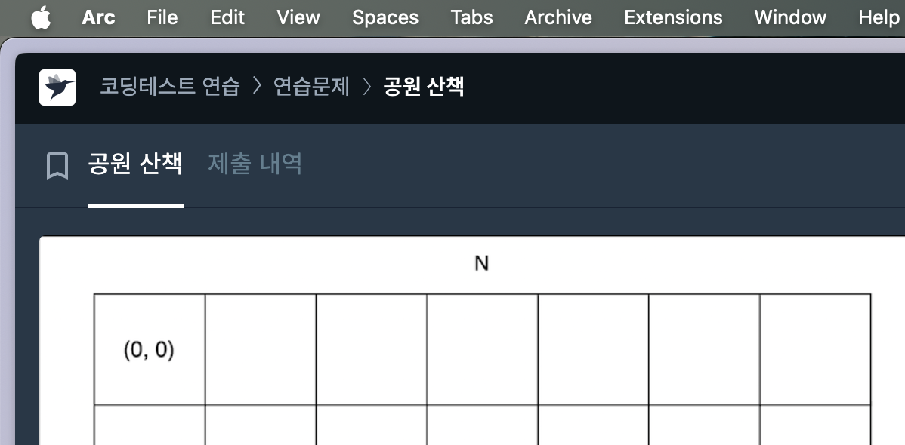

The examples are in **Java**, taken from my solution to [Park Walk on Programmers](https://school.programmers.co.kr/learn/courses/30/lessons/172928).

**What you’ll take away**

```text
When a problem gets confusing, you can print as much intermediate state as you need
and still keep those lines out of the output the judge sees.
```

<!-- truncate -->

## The short version

Define the `print(String format, Object... args)` helper below and use it wherever you want to inspect a value.

```java
// Example 1
print("Can move? now=%s(%d, %d)%n", mat[x][tempY], x, tempY);
print("Move allowed! now=%s(%d, %d)%n", mat[x][tempY], x, tempY);
print("Move (Y): %d -> %d%n", y, tempY);
// Example 2
print("=== step %d (start_%s) | oper_%s ===%n", count++, start, oper);


public static final boolean DEBUG_MODE = false;

private static void print(String format, Object... args) {
    if (DEBUG_MODE) System.out.printf(format, args);
}
```

## What I was struggling with

I kept getting my bearings wrong at first: how far did I need to search, and from which starting point? I wanted to see the intermediate results, so I started with plain `System.out.println()` calls.

I soon got tired of <u>typing the same output method over and over</u> and <u>joining strings with</u> `+` <u>just to inspect a value</u>. I wrote `print()` to take care of both.

```java
private static void print(String format, Object... args) {
    System.out.printf(format, args);
}
```

* A short helper takes care of <u>typing the same method repeatedly</u>.
* `printf()` and the varargs parameter `Object... args` take care of <u>assembling debug messages with string concatenation</u>.

## An excerpt from my solution

```java
    public static char[][] mat = new char[55][55];
    public static int ROW_SIZE;
    public static int COL_SIZE;

    public int[] solution(
        String[] park, // Each cell contains S, O, or X.
        String[] routes // Commands for the dog, in the form "op n": direction and number of squares
    ) {
        ROW_SIZE = park.length - 1;
        COL_SIZE = park[0].length() - 1;

        Pos start = new Pos();
        print("<ROW_SIZE=%d, COL_SIZE=%d>%n", ROW_SIZE, COL_SIZE);
        for (int row = 0; row < ROW_SIZE + 1; row++) {
            for (int col = 0; col < COL_SIZE + 1; col++) {
                char target = park[row].charAt(col);
                mat[row][col] = target;
                if (target == 'S') start = new Pos(row, col);
            }
        }

        for (int row = 0; row < ROW_SIZE + 1; row++) {
            for (int col = 0; col < COL_SIZE + 1; col++) {
                print("%s ", mat[row][col]);
            }
            print("%n");
        }

        int count = 1;
        for (String oper : routes) {
            print("=== step %d (start_%s) | oper_%s ===%n", count++, start, oper);
            if (start.canMoveTo(oper)) {
                start.move(oper);
            }
        }

        int[] answer = {start.x, start.y}; // Dog’s final position after all commands: [row, column]
        return answer;
    }
```

---

[Original post on Rilog (Korean)](https://www.rilog.kr/@homo_scribens/posts/328)
